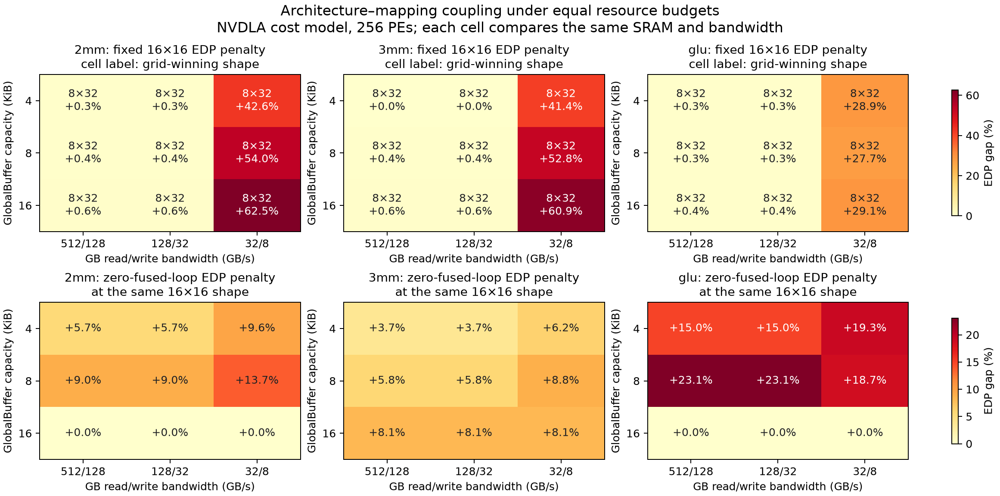

# Graph-structured architecture–mapping co-optimization

The research objective is to choose **one global hardware architecture** and
legal mappings for its tensor graph:

\[
\min_{a,m\in\mathcal M(G,a)}E(G,a,m)T(G,a,m),\qquad r(a)\le b.
\]

Different operators may choose different tiles, spatial unfoldings, storage and
fusion decisions, but they run on the same chosen hardware. Resource demand
must follow the supported execution/Reservation semantics. Sequential stages do
not consume separate chips whose PE counts should be summed.

Reservation ledgers, checkpoints, membership, caches and region compilers are
supporting infrastructure and baselines. A new container or more fixed-FFM
pruning is not the research objective. No new joint optimizer is claimed here.

## Correct reference and research questions

For a finite architecture set, **complete** per-architecture mapping searches
followed by architecture selection already solve the joint optimization:

\[
\min_a\min_{m\in\mathcal M(G,a)} f(a,m)
=\min_{(a,m):m\in\mathcal M(G,a)} f(a,m).
\]

The disadvantage is repeated search cost, not an inherent quality penalty.
Current FFM is a policy/heuristic search with a conservative Fusion space, so our
grid reference means **best returned by that declared contract**, not a certified
global optimum over all physically legal mappings. A legal migrated mapping can
in principle beat it; negative measured gaps must be retained.

- **RQ1, coupling:** How do mapping and hardware choices depend on each other?
  Measure fixed-shape/reoptimized-mapping and frozen-mapping/reselected-shape
  restrictions against independent architecture × FFM searches. Record actual
  mapping decisions, tied solutions, resource requirements and graph interfaces.
- **RQ2, decomposition:** Can a sound decision/factor representation reduce
  combinations before their full mappings are generated or composed? Distinguish
  computation connectivity, AND/OR alternatives and constraint dependencies.
- **RQ3, scaling:** Compare equal-quality search cost and equal-budget search
  quality against independent FFM, FFM + cache and existing parametric search.
  Include preparation, candidate generation, model evaluations and domain costs.

RQ1 is measured below. The [decision-hypergraph gate](DECISION_HYPERGRAPH.md)
starts RQ2 without claiming a complete factor decomposition or new search order.
RQ3 requires an actual new algorithm and is not answered by these diagnostics.

## RQ1 protocol

The primary grid uses NVDLA's existing fixed topology with 256 configured PEs:

| Axis | Values |
| --- | --- |
| Array shape | 8×32, 16×16, 32×8 |
| GlobalBuffer | 4, 8, 16 KiB, compared in exact integer bits |
| GB read/write bandwidth | 512/128, 128/32, 32/8 GB/s |
| MainMemory | Fixed 38.4 GB/s |
| Workload | 2mm/3mm: M=64, KN=128; GLU: M=32, G=64, C=128 |

2mm/3mm are the repository's **serial MatMul chains**. GLU is the existing four
contraction proxy, omitting activation and residual operations. It has branches,
an internal merge and a shared external input. It is not a complete neural model.

Every `(PE count, SRAM bytes, GB bandwidth)` defines a separate resource stratum.
Only array shape is selected within that stratum. We do **not** choose the largest
SRAM or bandwidth for free across strata. Equal PE counts also do not establish
equal physical layout area, interconnect cost or clock.

The component model has fixed unit action energies, zero leakage and fixed
clock. Bandwidth changes scale GB action latency only; port area and energy do
not change. No calibrated common area budget is available. Results therefore
describe this model's resource/performance envelope, not a physical chip optimum.
Memory hierarchy and PE count are not varied in the primary experiment.

Each point independently generates all normal FFM templates under Energy |
Latency | Resource Usage and the existing conservative Fusion filter. No
cross-target generation/cache scope is enabled. Selected mappings are rebuilt
and re-evaluated on their exact shape, capacity and bandwidth; capacity and each
spatial dimension are checked. All numeric frontiers and selected structures are
archived. Re-evaluation uses FFM's model, not an independent physical oracle.

Two restricted design policies are compared within each stratum:

1. **Fixed 16×16, mapping reoptimized.** This measures the cost of a prechosen
   shape, not a defect of exhaustive architecture enumeration.
2. **One frozen anchor mapping, shape reselected.** The anchor is selected first
   at 16×16, 8 KiB and nominal bandwidth; no target winner is used to construct it.
   Re-evaluate unchanged decisions at targets where spatial/capacity constraints
   permit. No rebinding/retile is performed. Infeasibility is recorded separately
   with null regret, never filled with a made-up numeric cost. These are physical
   feasibility evaluations, not claims of target FFM policy membership.

A third control limits `max_fused_loops=0` on the **same graph and nominal
hardware**. It can retain whole intermediate tensors on-chip and is not an
all-DRAM or independent-layer baseline. It tests the value of permitted
cross-operator loop granularity, not all possible meanings of Fusion.

## Measured coupling



There are 81 primary independent searches and 27 control searches, with all
108 selected result instances reconstructed and re-evaluated. The primary
selected identities number 10/10/12 for 2mm/3mm/GLU; repeated bandwidth/capacity
selections are not independent mapping designs.

| Workload | Largest fixed-16×16 EDP gap | Largest feasible frozen-anchor gap | Infeasible frozen-anchor strata | Largest zero-fused-loop control gap |
| --- | ---: | ---: | ---: | ---: |
| 2mm | 62.50% | 143.29% | 3/9 | 13.71% |
| 3mm | 60.95% | 147.78% | 3/9 | 8.83% |
| GLU proxy | 29.07% | 55.41% | 3/9 | 23.08% |

Maxima can come from different cells; they are not additive contributions or
speedups. All three primary grids choose 8×32 at every stratum. Thus this grid
shows a changing **penalty** for a fixed shape, not an architecture-ranking
reversal. Its 19/18/21 adjacent complete-tied-set changes (2mm/3mm/GLU) describe
mapping switches; they must not be relabeled architecture switches.

The full schema distinguishes a change in deterministic selected Mapping ID
from disjoint complete sets of near-tied returned mappings (relative 1e-6).
Truncated tied sets cannot certify the latter. Graph observations retain actual
loop/nesting and intermediate storage declarations; they are not new sufficient
physical interfaces or lifecycle proofs.

### Separate reproduction of the known ranking reversal

The pre-existing larger witness is independently re-run with native Energy |
Latency searches at 6,144 PEs and nominal bandwidth. This is a separate targeted
validation, not another cell of the 256-PE primary grid. All six picks pass their
own reconstruction checks.

| Shape | 128 KiB EDP, 10^-10 J s | 132 KiB EDP, 10^-10 J s |
| --- | ---: | ---: |
| 16×384 | 6.042042 | 3.750344 |
| 32×192 | 4.778393 | **3.470097** |
| 64×96 | **4.288793** | 3.487105 |

At 128 KiB, fixing 32×192 costs about 11.42% relative to 64×96; equivalently,
choosing 64×96 improves EDP by 10.25% relative to 32×192. These denominators
must not be interchanged. At 132 KiB, 32×192 leads 64×96 by only about 0.49%.
The case reproduces the capacity-dependent shape ordering, within the fixed
action/clock model; no wiring or physical-area conclusion follows.

## What this establishes, and what it does not

Mappings can require different array dimensions and exact SRAM demands;
bandwidth changes which fixed-shape mapping is competitive. Restricting the
available cross-operator loop structure also changes achievable cost. A single
mapping or arbitrary hardware shape is therefore not a sufficient design policy.

These findings do **not** establish a new co-optimization algorithm, a necessary
advantage for every graph decomposition, or a search-speedup over FFM + cache.
The timed totals include one serial diagnostic grid, selections, validations,
frozen mapping evaluations and controls, without randomized repeated benchmark
measurement. Quality comparisons are not equal-search-time comparisons.

The next algorithm gate is an executable factor decomposition of the important
couplings, with explicit physical requirements and valid aggregation laws.
Computational adjacency or an observed mapping hash alone cannot supply that
decomposition. Do not expand MIP, Ledger or Memo infrastructure on the assumption
that the decomposition will automatically exist.

## Reproduce

```sh
python -m research.graph_coopt.architecture_mapping_coupling --workload matmuls --params 2,64,128 --output research/graph_coopt/results/coupling/2mm.json
python -m research.graph_coopt.architecture_mapping_coupling --workload matmuls --params 3,64,128 --output research/graph_coopt/results/coupling/3mm.json
python -m research.graph_coopt.architecture_mapping_coupling --workload glu --params 32,64,128 --output research/graph_coopt/results/coupling/glu.json
python -m research.graph_coopt.plot_architecture_mapping_coupling --directory research/graph_coopt/results/coupling
python -m research.tracking_audit.shape_capacity_audit --workload matmuls --params 3,256,256 --shapes 16x384,32x192,64x96 --capacities-bytes 131072,135168 --methods independent --output research/graph_coopt/results/coupling/known_shape_reversal.json
```

The shared declared research regression passed **650 tests** in 211.78 seconds,
including 14 new coupling/hypergraph tests. Logs are in
`results/decision_hypergraph/{targeted,regression}.txt`. This is not an
all-repository test claim. The previously documented legacy
`compatibility_util` collection issue remains outside that set.
