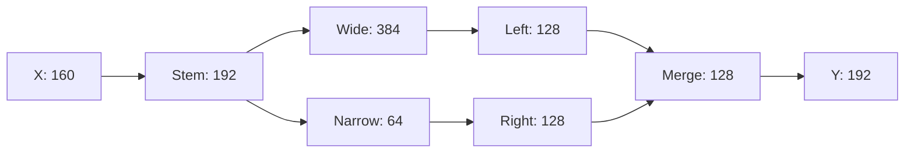

# asymmetric：贪心为什么失败，是否需要精确搜索

结论：一步贪心过早扩展窄分支，延迟共享输入的释放，导致后续宽分支执行时峰值变大。
两步前瞻已经能修复这个实例，因此它不是全局精确 DP 必要性的证据。
完整穷举、四个贪心 witness、前瞻 witness 和分叉后的最优完成值保存于
[asymmetric_audit.json](results/asymmetric_audit.json)。

## 图与内存语义

来自仓库 `research.runtime.dag_cases.asymmetric`，193 行、FP16。
图中数值是每行元素数，字节数 = 数值 × 193 × 2。权重与算子内部 staging 不计。



完整张量 materialization：算子执行时输入、新输出及其他仍活跃张量共存；
算子完成后再释放最后使用的输入。比较的是 `event_bytes`，不是切口峰值。

## 决策失误发生在哪里

四种一步贪心都选 `Stem → Narrow → Right → Wide → Left → Merge → Y`。
关键在 `Stem → Narrow` 后：

| 下一步 | 此步需共存的张量宽度 | 此步执行容量 | 选择后最好的完整执行峰值 |
| --- | --- | ---: | ---: |
| Right | Stem 192 + Narrow 64 + Right 128 | 144.75 KiB | 265.375 KiB |
| Wide | Stem 192 + Narrow 64 + Wide 384 | 241.25 KiB | 241.25 KiB |

`Right` 当前便宜，却把 Narrow 的 64 扩成 Right 的 128；Stem 还必须供 Wide 使用，不能释放。
随后 Wide 执行需要 `Stem 192 + Right 128 + Wide 384 = 704`，即 265.375 KiB。

先做 Wide 则允许 Stem 在该步完成时释放，剩下 `Narrow 64 + Wide 384`。
再做 Left 时为 `Narrow 64 + Wide 384 + Left 128 = 576`；
全程最大值是此前的 640，即 241.25 KiB。减少 24.125 KiB，约 9.09%。

## 所有顺序与更强基线

固定首尾 `Stem` 和 `Merge → Y` 后，只有 6 种合法中间顺序：

| 中间顺序 | 执行峰值 KiB |
| --- | ---: |
| Wide, Left, Narrow, Right | 265.375 |
| Wide, Narrow, Left, Right | 241.25 |
| Wide, Narrow, Right, Left | 241.25 |
| Narrow, Wide, Left, Right | 241.25 |
| Narrow, Wide, Right, Left | 241.25 |
| Narrow, Right, Wide, Left | 265.375 |

两步 receding-horizon 前瞻为每个 ready 算子比较“当前执行峰值和下一步最小可能峰值的较大者”，
然后只执行第一步并重算。它得到 `Stem,Narrow,Wide,Left,Right,Merge,Y`，达到精确最优。
这不是对任意 DAG 的保证，只说明该失败可由便宜的前瞻修复。

首轮全部精确实例的执行峰值对照：

| 策略 | 达到最优的实例数 |
| --- | ---: |
| 原始顺序 | 13 / 21 |
| 一步 event 贪心 | 16 / 21 |
| 四个一步贪心分别运行、取执行峰值最小者 | 20 / 21 |

四贪心组合只在 asymmetric 上存在差距；6 分支 breadth-first 对照的 81.25% 收益，
四种一步贪心全部都能取得，不能用它证明精确算法的优势。

复现（仓库根目录，标准库 Python）：

```powershell
python -m research.graph_structure.asymmetric_audit
python -m pytest -q research/graph_structure/test_analyze.py
```

测试独立枚举 6 种合法顺序，验证恰有 4 种为 247040 B、2 种为 271744 B，
同时验证四贪心失败和两步前瞻成功。物理成本模型、spill 和 tiling 尚未接入此对照。
