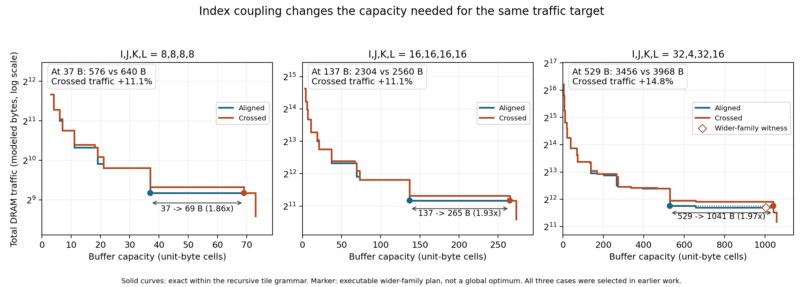

# Common-buffer coupling effects, independently replayed

The established coupling examples have a direct fixed-budget consequence:
crossed indexing needs 11.1%, 11.1% and 14.8% more DRAM traffic at the selected
common buffer capacities. Independent cell execution confirms these counts
after the cache-key projection. The extra traffic can be traced to partial-sum
stores/reloads and the accompanying changes in input reuse.

These are controlled comparisons of **different index-coupled computations**,
not two interchangeable implementations of one mathematical function. They
show a workload-dependent resource demand, not an optimizer speedup. The
three shapes and traffic targets were already used in CONSTRUCTIVE_RESULTS.md;
this is post-observation effect reporting and regression validation, not a new
held-out prediction.



## 1. Same buffer, different traffic

Cells occupy one modeled byte; memory has two levels; there is no recomputation.
Within each pair, I=K makes operation counts and tensor footprints match.
All complete regenerated numerical curves match their archived counterparts.

| I,J,K,L | Common buffer | Aligned traffic | Crossed traffic | Crossed excess |
|---|---:|---:|---:|---:|
| 8,8,8,8 | 37 B | 576 B | 640 B | 11.11% |
| 16,16,16,16 | 137 B | 2,304 B | 2,560 B | 11.11% |
| 32,4,32,16 | 529 B | 3,456 B | 3,968 B | 14.81% |

The common capacity is the aligned graph's archived minimum for the previously
selected traffic target. It is not a per-case capacity newly selected to
maximize the percentage. These three examples are not an all-workload average.

## 2. Equal traffic target, different capacity

| Shape | Traffic must be at most | Aligned minimum | Crossed minimum | Ratio |
|---|---:|---:|---:|---:|
| 8,8,8,8 | 576 B | 37 B | 69 B | 1.865 |
| 16,16,16,16 | 2,304 B | 137 B | 265 B | 1.934 |
| 32,4,32,16 | 3,456 B | 529 B | 1,041 B | 1.968 |

These minima are over the recursive model's declared tile grammar, not over
all possible physical schedules. At 1,041 B the selected crossed plan actually
transfers 2,944 B: meeting a target means **at most**, not exact equality.
The horizontal annotations in the figure mark the capacity thresholds for
that inequality.

The wider integer-strip family remains visible as a separate control. For
(32,4,32,16), its crossed plan uses strips 11,11,10, retains B and V, occupies
**1,004 B** and transfers **3,328 B**. It independently replays correctly and
meets the same 3,456 B target. Thus 1,041 B is not a physical lower bound.
The 1,004/529 = 1.898 ratio compares the selected feasible constructions;
this incomplete wider family does not prove the unrestricted optimal ratio.
For the other two examples the selected wider-family thresholds remain 69 B
and 265 B. See CONSTRUCTIVE_RESULTS.md for the earlier grammar ablation.

## 3. Where the extra bytes actually come from

The selected crossed plans at the common capacity spill **U**, not V. A
formula for one row-oriented construction must not be mistaken for the
identity of the optimized plan's exposed accumulator.

At 529 B in the third example, the independent machine records:

| Traffic component | Aligned | Crossed |
|---|---:|---:|
| Reads of original inputs A,B,C,D | 2,432 B | 1,920 B |
| Partial-sum reloads of U | 0 B | 512 B |
| Writes of U and V, including intermediate U writeback | 1,024 B | 1,536 B |
| Total | 3,456 B | 3,968 B |

The crossed plan adds 512 B of partial-sum stores and 512 B of reloads, while
its changed input reuse saves 512 B. The net premium is consequently **512 B**,
not the full 1,024 B partial-sum traffic. At the larger target-meeting capacity
the selected crossed plan no longer spills partial sums. The other two
examples have the analogous 64 B and 256 B net premiums.

This supplies a physical explanation for the plotted difference, with exact
per-tensor reads and writes. It does not predict device latency or energy;
those need bandwidth, overlap, compute and memory-energy assumptions.

## 4. Verification and provenance

All new model evaluations and cell executions ran in a clean checkout of
**1d170433** on the designated experiment machine. Source and input hashes
are included in the metadata of the raw file. Plot rendering uses those
archived results and performs no mapping search.

| Check | Result |
|---|---:|
| P18 small curves, numerical agreement with archive | 28/28 |
| Every point of those curves independently executed | 212/212 |
| Common-budget and target-meeting recursive witnesses | 9/9 |
| Wider-family target-meeting plans | 6/6 |
| New independent executions in total | 227/227 |

Numeric output values, complete arithmetic coverage, capacity and traffic are
checked by the cell simulator; the wider plans additionally compare per-tensor
reads and writes to their constructive formulas. These checks supplement the
already completed 475 archive-comparison jobs at 7b891c7c/f254b7a6; they are
not another full rerun of that suite.

`verify_projection.py` now actually executes witness-mode results, offers
`--witness-only`, and exits nonzero on mismatch. A temporary negative control
replaced the task list with a deliberately wrong tiny-graph expected curve:
it reported one mismatch and exited 1. No archived reference was edited.

[Raw effects and witnesses](results/projected_effect_replay/focus.jsonl) ·
[P18 execution checks](results/projected_effect_replay/p18_witnesses.txt) ·
[Validation manifest](results/projected_effect_replay/validation.json) ·
[Vector figure](results/projected_effect_replay/common_budget_effects.svg)

Reproduce from the pinned checkout:

```sh
PYTHONHASHSEED=0 python -B -m research.index_coupling.verify_projection 2 --witness-only
PYTHONHASHSEED=0 python -B -m research.index_coupling.replay_budget_effects replay > focus.jsonl
python -B -m research.index_coupling.replay_budget_effects plot focus.jsonl figures
```

The long P19 and remaining FFN runs are separate experiments. Neither their
verdicts nor their end-to-end performance are inferred from this replay.
