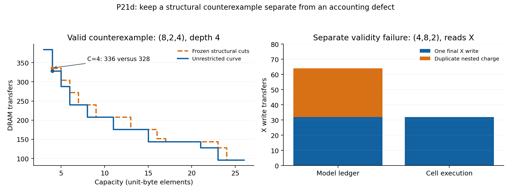

# P21d: frozen structural cuts fail; nested write accounting also needs repair

The frozen structural-cut prediction is **falsified on four cases whose saved
frontier witnesses all replay exactly**. Two other cases have equal curves.
Two cases fail the independent accounting check and are excluded from the
equality score. Depth-12 coverage is reported separately below. This rejects
the particular frozen cut generator; it does not prove that the proposed
lifecycle labels are insufficient.

The accounting failure is inherited from the pre-P21d solver: two nested
partitions charge the same final X write. No solver cost was changed and no
cut was added after seeing these results. The original measurements remain
the frozen outcome.

## Frozen question and provenance

The protocol was committed as `899ecd8d` before held-out curve evaluation.
The experiment used source `0a1d5cff`; scoring and post-hoc diagnostics were
added in `c7b3ee18`. The protocol SHA-256 is
`d4389e8d936dbd3e27cc22e6097790cf65ce272c7438889296076e0e0b8f7b34`.
See [PROTOCOL.md](PROTOCOL.md) and
[the execution manifest](results/p21d/manifest.json).

There are 12 cases: shapes (8,2,4) and (4,8,2), H depths 4, 6 and 12,
with and without H reading X. Including EX and the join, these have 6, 8 and
14 operators. All elements use the existing unit-byte convention.

For a cut k in whole span S, the generator checks adjacent **whole-prefix or
whole-suffix** legal-rank sets, and last uses of tensors accessed by at least
two distinct operators in S. An empty prefix has no automatic rank event;
a one-use weight/input is not a crossing tensor. Every subset of selected
positions is permitted. The restriction applies to the first nontrivial
whole-span partition even after whole-span loops; proper child spans retain
the full solver. This is a precise, limited interpretation of the proposed
two event classes, not a test of every possible local-span interpretation.

The pre-search audit selects cuts 2 through n−1 in every case. Only cut 1,
immediately after EX, is excluded. Thus the experiment is non-vacuous, but
does not establish substantial positional compression:

| H depth | Selected / possible positions | Allowed / all partition masks |
| --- | --- | --- |
| 4 | 4 / 5 | 16 / 32 |
| 6 | 6 / 7 | 64 / 128 |
| 12 | 12 / 13 | 4096 / 8192 |

The empty mask permits looping before partitioning. Retention choices and
H_last residency remain exhaustive. The frozen target is exact equality at
every integer capacity and on the constant tail, with exact independent
capacity/traffic replay of every saved frontier witness.

Each arm ran in a fresh server process with an 8 GiB address-space limit and
a 600-second search-plus-replay limit; at most four ran simultaneously.
Timeouts do not become passes, equality failures, or omitted cases.

## Results and coverage

| Case | Shape | H depth | H reads X | Result | Wrong capacities | Seconds: structural / unrestricted |
| --- | --- | --- | --- | --- | --- | --- |
| 00 | (8, 2, 4) | 4 | no | **unequal** | 11 | 0.24 / 0.34 |
| 01 | (8, 2, 4) | 4 | yes | **unequal** | 12 | 0.27 / 0.39 |
| 02 | (8, 2, 4) | 6 | no | **unequal** | 11 | 2.08 / 3.29 |
| 03 | (8, 2, 4) | 6 | yes | **unequal** | 12 | 2.35 / 3.88 |
| 04 | (8, 2, 4) | 12 | no | incomplete: both timed out | — | 600.12 / 600.00 |
| 05 | (8, 2, 4) | 12 | yes | incomplete: both timed out | — | 600.16 / 600.61 |
| 06 | (4, 8, 2) | 4 | no | equal | 0 | 0.22 / 0.28 |
| 07 | (4, 8, 2) | 4 | yes | **invalid replay** | — | 0.23 / 0.32 |
| 08 | (4, 8, 2) | 6 | no | equal | 0 | 1.74 / 2.54 |
| 09 | (4, 8, 2) | 6 | yes | **invalid replay** | — | 1.93 / 2.94 |
| 10 | (4, 8, 2) | 12 | no | incomplete: both timed out | — | 600.11 / 600.04 |
| 11 | (4, 8, 2) | 12 | yes | incomplete: both timed out | — | 600.39 / 600.02 |

All 24 bounded jobs terminated. Eight case pairs have full curves; all eight
depth-12 arms timed out during search, leaving four incomplete cases. The
maximum recorded process RSS was 3.06 GiB. The completed depth-4/6
arms each took under four seconds. The large jump at depth 12 is an observed
search cost of this grammar and runner, not evidence for or against equality.

The six cases with clean paired frontiers contain four unequal and two equal
curves. The four unequal cases have 46 discrepant (case, integer-capacity)
points in total. Every completed pair reaches an equal constant tail. The
two nominal 32-byte discrepancies in invalid cases are excluded from that
46-point count.

There are 160 independently executed frontier witnesses: all produce correct
outputs and match predicted peak capacity; 158 also match traffic. The other
two overcount traffic by 32. Replay validates these particular schedules; it
does not prove that every discarded schedule was priced correctly. Therefore
the equality verdict concerns the **frozen recurrence and cut rule**, not a
claim about the physical optimum of a future corrected solver.

## A clean counterexample: a local rank opportunity is missed

At shape (8,2,4), depth 4, H not reading X, and capacity 4:

| Arm | Predicted traffic | Independently executed traffic / peak |
| --- | --- | --- |
| Frozen structural cuts | 336 | 336 / 4 |
| Unrestricted | 328 | 328 / 4 |

The unrestricted witness starts with
`EX | EH0 | EH1,EH2,EH3,EAdd`, using cuts 1 and 2. The frozen rule excludes
cut 1. Its selected candidate first loops over I, then splits
`EX,EH0 | EH1,EH2,EH3,EAdd`. It can later split EX from EH0 inside that
smaller child, but the outer I context is already fixed.

EH0 alone permits L outside I, retaining W0 across I. In the selected
candidate, I lies outside that L loop. The independent executions isolate
the entire difference:

| Transactions | Structural | Unrestricted | Unrestricted − structural |
| --- | --- | --- | --- |
| W0 reads | 64 | 8 | −56 |
| D reads | 16 | 64 | +48 |
| All other reads and writes | 256 | 256 | 0 |
| Total | 336 | 328 | −8 |

Cut 1 changes neither of the frozen adjacent whole-prefix/suffix rank sets
and is not a last crossing use. Nevertheless, paired with cut 2 it isolates
a useful singleton subspan. The missing information here is the interaction
between cut endpoints and the loop opportunities of the resulting child.
This diagnoses an incomplete event generator. It does not establish a missing
lifecycle label, nor justify adding cut 1 and calling the amended rule a
held-out success.



## Separate validity failure: one final store, two recursive charges

For (4,8,2), H reading X, the first structural frontier point is invalid:

| H depth | Model (capacity, traffic) | Cell execution (peak, traffic) |
| --- | --- | --- |
| 4 | (3, 488) | (3, 456) |
| 6 | (3, 552) | (3, 520) |

In both witnesses X has 32 cells. A parent partition drops X to DRAM and
charges its final write. The child `EX | EH0` also drops X and charges the
same write. With loop multiplicities included, the model charges 64 X writes;
the executor performs 32. All reads agree. Once X has been written, later
consumers can reuse its DRAM copy without another dirty store.

A tiny post-hoc check loads `graph/curve.py` from **pre-P21d `4b3f7f02`**,
forces `EX,EH0 | EH1,EH2,EH3,EAdd`, and caps capacity at 3. It reproduces
488 predicted versus 456 executed. The new cut filter therefore did not
introduce this defect. Source hash, witness and execution are saved in
[legacy_accounting_proof.json](results/p21d/legacy_accounting_proof.json).

The existing global `written` option can represent caller-precharged writes,
but a recursive partition does not pass its own new final-write charge to
its children. A diagnostic ledger that gives the ancestor ownership of that
charge and suppresses the duplicate child charge matches the reads, writes
and traffic of **all 160 saved executions**. Its ordinary ledger also exactly
reproduces all 160 model prices. This isolates a plausible repair, but only
reprices saved witnesses: it does not reoptimize, validate discarded mappings,
or establish a generally sufficient ownership state. See
[diagnostics.json](results/p21d/diagnostics.json).

The next correctness task is to define unique ownership of each physical
final store across recursive composition, distinguish it from partial-sum
stores, and include any necessary state in the projected cache key. Repair
and regression belong to a separately versioned experiment. P21d remains
failed under its frozen implementation; the two invalid cases remain invalid.

## What follows for the research question

P21d separates two obligations that a compositional summary must satisfy:

1. A cut generator must preserve useful local loop contexts, including those
   exposed jointly by two cut endpoints. Whole-prefix/suffix events alone
   do not do so here.
2. A cost composition must count each physical transfer once. Residency and
   release timing do not by themselves specify who owns a final-store charge.

These observations motivate further state/proof work; they do not prove a
minimal interface or require a particular new label. The cache projection
argument remains about equivalence of recurrence states. Its equivalence
does not make a faulty recurrence an exact physical cost model. Earlier
exact replay results remain evidence for the schedules actually checked.

Repair the accounting before the next contract-sufficiency experiment.
Do not add a cut family to rescue P21d, move to overlap/P22, or interpret
timeouts as an architectural result. The earlier 5%/32%/63% decomposition
also remains an order- and domain-dependent sequential attribution, not a
unique division of causal contributions.

## Reproduction

From the repository root, source `0a1d5cff` generates the pre-search audit and
one bounded arm as follows. The full run used both arms for indices 0..11.

```sh
python -m research.index_coupling.run_p21d --prepare > cuts_before_search.json
P21D_SOURCE_REVISION=0a1d5cff428b386c0c97ea6cb58e94d0350aa8ce PYTHONHASHSEED=0 python -m research.index_coupling.run_p21d --case 0 --arm structural --output 00_structural.json
```

The scoring and diagnostic commands read saved records; they do not search.
The scorer intentionally exits 1 for a failed or incomplete experiment.

```sh
python -m research.index_coupling.score_p21d research/index_coupling/results/p21d
python -m research.index_coupling.diagnose_p21d research/index_coupling/results/p21d
python -m research.index_coupling.plot_p21d research/index_coupling/results/p21d
```

Seven small P21/P21d regression tests pass. They check default compatibility,
all-cut equivalence, constraints after whole-span loops, structural invariance,
argument validation and witness replay. They are implementation checks, not
additional held-out experimental evidence. Raw arms, full error intervals,
witnesses and cut reasons are retained under `results/p21d/`.
