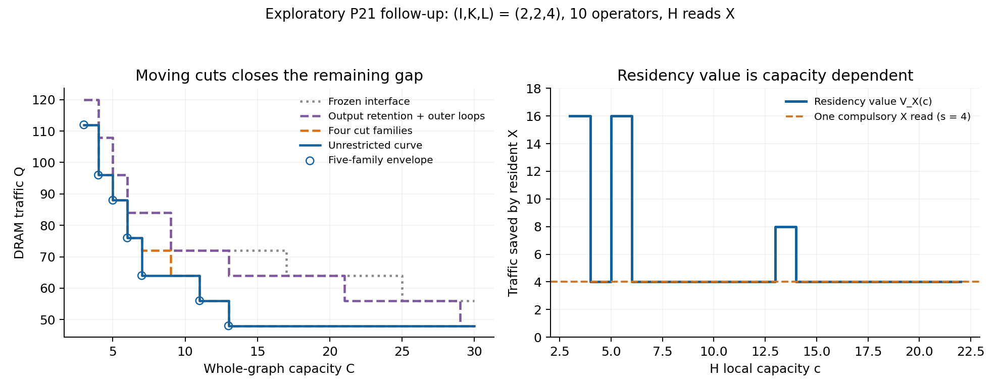

# P21 follow-up: residency value, cut position and release time

This is exploratory analysis of the already-seen P21 graphs and witnesses,
not a new frozen prediction. All new experiments ran on the user-designated
server. The original protocol and solver are unchanged.

The new result is twofold. The retain/spill inequality has an exact conditional
extension when H reads X. Recovering the unrestricted curve additionally needs
cut placement and the ability to end an input's reservation at its last use.
A five-family cut envelope matches all 16 observed curves, but the fifth family
was selected from the four residual failures; this is not held-out evidence or
a theorem that five families suffice in general.



## 1. The exact extension of the 2s inequality

Fix the same endpoint contract as P21, with H_last materialized, X of size s,
and all other boundary conditions fixed. Write

    Q0(c) = Q_H(c | X in DRAM)
    Q1(c) = Q_H(c | X resident, its allocation charged by the caller)
    V_X(c) = Q0(c) - Q1(c).

On the finite domain with compatible producer/join endpoints, the exact costs
are K(C)=3s+Q1(C-s) and D(C)=5s+Q0(C). Rearranging gives

    keep strictly wins iff
    Q0(C-s) - Q0(C) < 2s + V_X(C-s).

Equality is a tie. If a conditional branch is infeasible, compare K and D
directly; do not subtract infinities. For arbitrary endpoints, their cost
and feasibility differences replace the constant 2s.

The left side is the traffic cost of taking s capacity away from H. The right
side combines the avoided cross-group write/read (2s) with the benefit of H
itself accessing resident X. P21a is precisely V_X=0. In P21b, V_X is a curve,
not generally a constant compulsory-read credit.

For (I,K,L)=(2,2,4), depth=8, s=4, C=9:

    Q0(5)=76, Q0(9)=64, Q1(5)=60
    capacity cost = 76-64 = 12
    residency value = 76-60 = 16
    original threshold: 12 > 8, predicting spill
    conditional threshold: 12 < 8+16, predicting keep
    exact branch costs: keep 72, spill 84.

V_X(c) is nonmonotone: at local capacities c=3,4,5,6 its values are 16,4,16,4.
Across the eight full read-X cases its minimum is s and its maximum ranges
from 2s to 4s. Neither one fixed read credit nor a single switch capacity
summarizes these decisions. The generalized comparison matches the archived
monolithic branch choices at all 212 finite eligible capacities across both
read modes. This is a checked algebraic consequence of the conditional curves,
not an independent physical lower bound.

## 2. Separate output residency from the outer-loop control

The earlier exploratory `attribute_p21.py` calls
`curve(..., root_groups=groups)` with `root_kept=None`. This permits retaining
H_last, while frozen P21 forced H_last through DRAM. Its column named `fixed`
therefore means **fixed partition with flexible output residency**, not the
original frozen frontier.

That difference is material: in all 16 cases the frozen curve's plateau is
exactly 2|H_last|=2s above the unrestricted plateau. Allowing output residency
removes this plateau gap in every case. It does not recover the full curve.

For a consistent refinement ladder, score every stage on the same integer
capacity domain per case, through the largest last breakpoint among all stages.
The unrestricted curve must be feasible at a counted capacity. The finite-domain
counts below do not measure traffic-error magnitude, and the frozen curve's
positive plateau gap persists beyond the measured domain.

| Allowed choices | Wrong case-capacity pairs | Whole curves exact |
| --- | ---: | ---: |
| Frozen P21: fixed partition, H_last in DRAM | 423 | 0/16 |
| Same partition, H_last may stay resident | 402 | 0/16 |
| Plus all allowed I-loop contexts | 268 | 0/16 |
| Plus four chosen cut families | 7 | 12/16 |
| Plus the streamed-tail family | 0 | 16/16 |

The 54%/20% improvement reported previously compares the second and third
rows. It does not attribute the entire frozen-to-free gap to outer loops.
The ladder uses cumulative Pareto unions. Separately, the five new cut families
alone also reproduce every unrestricted frontier, without needing the old
fixed-partition frontier.

## 3. Cut position changes which ranks may be split

The first four menus specify the first nontrivial partition below the lifted
I-loop context. Retention choices within each partition are unrestricted:

| Menu | Bottom partition |
| --- | --- |
| join_only | EX / EH0..EH_last,EAdd |
| after_first | EX,EH0 / EH1..EH_last,EAdd |
| after_first_split_ex | EX / EH0 / EH1..EH_last,EAdd |
| after_pair_split_ex | EX / EH0,EH1 / EH2..EH_last,EAdd |

A slash is a group boundary. The original three-part boundary is EX / H / EAdd.
The full residual span admits only I as a whole-span loop: internally produced
and consumed H0 is indexed by (I,L), so it blocks K. Cutting after EH0 moves
H0's production outside the suffix. The suffix EH1..EAdd then admits I and K.
Its legal loop space changes even before pricing the extra boundary storage
and transfers. Bare tensor sizes or cut counts do not record this effect.

For these P21 outer contexts, external tensors are W0/W1, neither internally
produced. In general conditional calls, legality must also account for the
external set; the bare-incidence `span_ranks` helper is not a complete legality
signature for every possible external reservation.

No single tested menu reproduces all curves. `after_first` matches 6/16 full
curves, `after_first_split_ex` 5/16, and `join_only` 0/16. Their union with the
fourth menu matches 12/16. The four remaining discrepancies are small and exact:

| (I,K,L), H reads X? | Capacity C | Four-menu traffic | Exact traffic |
| --- | --- | ---: | ---: |
| (2,2,4), no | 8 | 76 | 68 |
| (2,2,4), yes | 7..8 | 72 | 64 |
| (4,2,2), no | 15..16 | 88 | 80 |
| (4,2,2), yes | 15..16 | 80 | 72 |

All four use depth=8. Their saved exact witnesses share the bottom partition

    EX / EH0,EH1 / EH2 / EH3 / EH4 / EH5 / EH6 / EH7,EAdd.

Adding this fifth, streamed-tail family closes all seven discrepant integer
capacities. It was explicitly chosen after inspecting these misses. The
streamed-tail menu alone matches 0/8 deep cases: it supplies particular missing
segments of the frontier, rather than one universal best mapping.

## 4. Why the tail needs entry mode and release time

A concrete conditional tail distinguishes two interface choices. Use the
(2,2,4) control after the outer I tile reaches one row. The tail is
EH2..EH7,EAdd. X and H1 each occupy two elements and enter as external tensors.
Its compulsory local traffic is 14: six two-element weights plus output Z.

| Tail entry | Local (capacity, traffic) frontier |
| --- | --- |
| group: must loop before partitioning | (13,14) |
| solve: may partition before looping | (3,38), (4,26), (5,14) |

These are the same extents, external tensor identities and bare legal ranks.
The entry mode changes the curve. In the current grammar the group entry
loops K to scalars, then the scalar leaf reserves all its local tensors;
this is a restriction of this grammar, not a hardware lower bound.

Even solve entry leaves a lifetime problem. Keeping both external inputs for
the entire macro-group adds four capacity units, so its minimum-traffic tail
uses 4+5=9. But H1 is last consumed by EH2 and can be released immediately
thereafter. The streamed-tail partition charges H1 only through that child.
The existing whole-graph witness reaches (capacity,traffic)=(8,68), including
the matrix operations. Thus changing entry mode alone does not make the coarse
fixed-lifetime macro interface exact at capacity 8.

A useful next interface should distinguish at least these meanings:

- Input is available on entry, may be released at its last use in the span.
- Input is pinned through the span because the caller needs it afterward.
- Output must be available at exit, or may be materialized.

This is a design requirement from counterexamples, not a claim that those
three labels alone are already a sufficient minimal quotient. Conditional
allocation semantics, extents, role and completion state still need explicit
contracts. A fixed-cut curve remains exact for its stated contract; it does
not automatically represent moving cuts and shorter reservations.

## 5. What to do next, and what this does not prove

Keep P22 deferred until the release-time interface has a held-out check.
A useful next test would vary tail depth and rectangular shapes not used to
select these menus, and test the interface rather than add more guessed
mapping families. That test is not frozen or executed here.

The five menus constrain only the first nontrivial partition under the whole
span's I-loop chain. Child curves still search their own recursive grammar.
This does not reduce the whole search to five schedules, prove minimality,
or establish a general normal form. It is a constructive explanation of the
16 already-seen frontiers.

P19 now independently shows why maximum-gap agreement is not whole-curve
prediction: its maximum gaps pass 8/8, but the predicted positive-width order
passes 0/8. The P21 evidence likewise points toward conditional scopes and
curve segments, not one scalar retention statistic. This is a connection
between the results, not a proof that the same mechanism causes both.

## Evidence and reproduction

- Round 1: 16 cases, four cut families, source `d18e072d`.
- Round 2: eight depth-8 cases, one additional family, source `81e034f7`.
- 560/560 new whole-graph witnesses replay with exact capacity and traffic;
  all 72 numeric context results agree with the independently constructed
  witness frontiers. No candidate falls below the unrestricted reference.
- Total serial case time 172.876 seconds; maximum case 50.690 seconds; maximum
  RSS 38,952 KiB. Two concurrent cases, each capped at 8 GiB and 600 seconds.
- `results/p21_cuts/` stores raw frontiers, witnesses, replay results, score
  intervals, residency-value steps, source revisions and archive hashes.

```sh
PYTHONHASHSEED=0 python3 -B -m research.index_coupling.analyze_p21_cuts --case 6
PYTHONHASHSEED=0 python3 -B -m research.index_coupling.analyze_p21_cuts --case 6 --streamed-tail-only
python3 -B -m research.index_coupling.summarize_p21_cuts research/index_coupling/results/p21_cuts
python3 -B -m research.index_coupling.plot_p21_cuts research/index_coupling/results/p21_cuts
```

The score fails on missing/incomplete cases, replay failures, context mismatch,
threshold disagreement or a curve below the reference. The raw per-case
comparisons retain the failed four-menu prediction rather than overwriting it.
