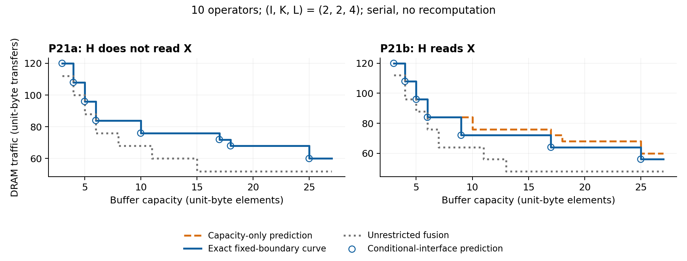

# P21: retain/spill and the boundary state

P21 completed on the user-designated experiment server, 2026-11-09. All 16
frozen cases completed within the resource limits. Eight have 10 operators;
eight have 4. P21 is independent of P19, whose ledger remains unchanged.

**Result:** the capacity-shift identity is exact when H does not access X.
When H reads X, all eight complete graphs refute the capacity-only prediction.
Conditioning on X's residency and the exact tile extents restores the entire
fixed-boundary frontier. This does **not** establish that a scalar H curve
predicts an unrestricted whole graph: every one of the 16 unrestricted curves
differs from the fixed-boundary curve.



## Frozen experiment and evidence

The protocol was committed before any P21 curve ran (`9f8ff612`). The experiment
source is `12afdb60b9072f309329fa452f339585f022bdba`; scoring and plotting were
added afterward. Raw records retain every conditional child curve, each keep
and spill branch, all capacity-error intervals, choice/tie intervals, complete
whole-graph witnesses, and independent cell-execution results.

- 16/16 full graphs; 64 conditional interface queries at four granularities
  each. Some tiles repeat across parent cases: there are 48 distinct
  (shape, depth, read-mode) interfaces, 40 feasible (20 per mode). Repeated
  queries have identical child and branch curves. Counts below are queries,
  not claims of 64 distinct states or 596 distinct execution plans.
- 56/64 interfaces are feasible. The other 8 are empty in the fixed-group
  grammar, and are **not** positive evidence. They have I=1 and depth=8:
  the fixed H group has no legal nontrivial outer loop. The full solver can
  still partition before looping; the fixed child entry cannot.
- P21a: 28/28 feasible interfaces have identical H curves with and without
  unused external X, exact composition, and no wrong eligible branch choice.
- P21b: 28/28 feasible interfaces distinguish resident X from DRAM X, and
  28/28 have a wrong capacity-only whole curve. The conditional interface
  reproduces both branches and their union exactly in all 28.
- 596/596 fixed-root and unrestricted witnesses execute with exactly the
  predicted peak capacity and traffic. The simulator evaluates products at
  multi-input operators; the final join is access-equivalent to addition.
  These are memory/traffic checks, not numerical addition validation.
- Serial experiment time: 198.393 seconds; slowest case: 42.471 seconds;
  maximum peak RSS: 68,704 KiB (67.09 MiB). Limits: 180 seconds and 8 GiB per
  case, one worker. Python 3.10.12, PYTHONHASHSEED=0, no approximate pruning.
- Default-API regression: **475/475** archived comparisons match and **212/212**
  historical witnesses replay exactly. The initial serial regression reached
  its 600-second wall limit and is recorded as incomplete; a four-worker run
  completed all 475 checks in 356.511 seconds, with 8 GiB per worker. The indexed
  records cover every task exactly once. Four small local interface contract
  tests also pass. These checks are separate from the 16 P21 experiments.

The table counts incorrect **integer capacities through the union's final
breakpoint**, with the constant tail checked separately. A wrong constant
plateau can extend indefinitely; the count is not an integral over an infinite
domain. Every P21b coarse curve also has the wrong plateau (one extra X read).

| (I,K,L) | Operators | P21a coarse errors | P21b coarse errors | Conditional prediction, a / b |
| --- | ---: | ---: | ---: | --- |
| (2, 2, 2) | 4 | 0 | 9 | exact / exact |
| (2, 2, 2) | 10 | 0 | 9 | exact / exact |
| (2, 2, 4) | 4 | 0 | 8 | exact / exact |
| (2, 2, 4) | 10 | 0 | 17 | exact / exact |
| (4, 2, 2) | 4 | 0 | 7 | exact / exact |
| (4, 2, 2) | 10 | 0 | 7 | exact / exact |
| (4, 4, 2) | 4 | 0 | 14 | exact / exact |
| (4, 4, 2) | 10 | 0 | 19 | exact / exact |

## What the inequality actually proves

Let the fixed partition be EX | H | EAdd, and materialize H_last. X is a dirty
internal tensor, produced once and consumed at the final join; its current
tile size is s. H's curve uses the same `group` entry as that child of the
recursion. Caller-owned resident tensors contribute neither child allocation
nor child compulsory transfers.

When H does not access X, adding X to the external set is projected away from
every cache key for H. Its accesses, legal loops, refetch weights and child
transitions are unchanged. Induction through the recurrence therefore gives
exactly the same additional-capacity/traffic frontier. The caller alone adds
s capacity during X's lifetime. Writing X once and reading it at the later
join instead costs 2s transfers. Thus the bridge costs are

    keep(C)  = Q_H(C-s)
    spill(C) = Q_H(C) + 2s.

Compare these costs directly at infeasible capacities; do not subtract two
infinities. On the finite domain,

    keep strictly wins iff Q_H(C-s) - Q_H(C) < 2s;
    equality means both choices are optimal.

For these particular copy/elementwise endpoints, their branch costs are 3s
while keeping X and 5s while spilling X. Their minimum capacities are s+2 and
3 respectively. Consequently the full fixed-boundary prediction is

    min(3s + Q_H(C-s), 5s + Q_H(C)),

with the endpoint feasibility gates applied. H's standalone traffic includes
writing H_last; the join includes reading it. For other endpoints the separate
producer/join curves must be composed, rather than assumed constant. In the
implementation, an independent Cartesian-product composition is compared with
the monolithic root-constrained recursion's staircase merge.

There need not be a single switch capacity. For P21a (I,K,L)=(2,2,4), depth=2,
spill wins for C=3..9, keep at C=10, spill at C=11..14, and keep for C>=15.
The finite difference of a decreasing staircase need not be monotone.

## P21b counterexample and repair

For the 10-operator (2,2,4) graph, s=4 and C=9:

| Quantity | Capacity-only | Exact conditional |
| --- | ---: | ---: |
| H traffic with 5 bytes of local capacity | 76 | 60 |
| Keep-branch whole traffic, including 3s endpoints | 88 | 72 |
| Spill-branch whole traffic | 84 | 84 |
| Minimum whole traffic | 84 | 72 |
| Choice | spill | keep |

At these exact same extents, Q_H depends on whether X is resident. Recording
only the grain cannot distinguish the two curves. The repaired comparison is

    3s + Q_H(C-s | X resident)
    versus
    5s + Q_H(C | X in DRAM),

again with endpoint feasibility. X's lifetime is fixed from producer to join;
it is not optimized in this experiment. The exact tested interface therefore
includes the entry mode/partition, extents, and residency, with the lifetime
charged by the caller. This is sufficient here, not a proof of a globally
minimal interface for arbitrary graphs.

A **post-hoc** diagnostic subtracts just s from the coarse retained H curve to
credit its compulsory X read. This still fails in 5/8 full P21b cases, including
C=9 above: 88-4=84 remains above 72. Residency also removes local storage and
repeated reads; the error is not always a compulsory-traffic bookkeeping offset.
See `summary.json:posthoc_compulsory_read_credit` for all intervals. This was
not an extra frozen prediction.

The tile tests change the exact conditional extents (I,K), keeping L unchanged.
They do not simulate an arbitrary partially retained region of a full tensor,
and they do not establish a grain-only repair for the unrestricted graph.

## Whole-graph boundary and next step

All 16 unrestricted curves differ from the fixed-interface predictions.
For the 10-operator control at C=9, the fixed result is 84 while the unrestricted
result is 68. For its read-X partner, they are 72 and 64. Unrestricted search
can change both grouping and retention of H_last, so these differences must
not be attributed solely to one fusion mechanism.

The saved unrestricted witnesses at C=9 make the missing state concrete: both
loop over I in tiles of one row, retain a 2-element X row across inner groups
(rather than all 4 elements), and fuse EH7 with EAdd. The control executes at
(capacity, traffic)=(8,68); the read-X graph at (7,64). Thus even the no-read
control can exploit a finer retention scope when the top boundary is released.

The original unqualified claim that Q_H alone determines the entire arbitrary
residual graph is therefore not supported. The fixed-interface identity and
conditional composition are exact. Endpoint and cut-state information must
survive before claiming whole-graph composability. P20 stays dependent on P19;
P22's overlap/double-buffer model remains a subsequent task. No bandwidth
crossover is claimed in this serial, constant-compute-work model.

## Reproduction

From the recorded source revision on the designated server:

```sh
PYTHONHASHSEED=0 python3 -B -m research.index_coupling.run_p21 --case 0
# Repeat --case 1 through 15, saving each stdout to case_XX.json.
python3 -B -m research.index_coupling.score_p21 research/index_coupling/results/p21
python3 -B -m research.index_coupling.plot_p21 research/index_coupling/results/p21
python3 -B -m unittest research.index_coupling.test_p21
python3 -B -m research.index_coupling.verify_projection 4
```

The runner automatically enforces per-case limits and records incomplete cases.
Scoring rejects missing, incomplete, wrong-shape, or wrong-protocol records.
Use the later scoring/plotting commit with the unchanged solver for those
commands. `manifest.json` records the source archive and protocol SHA-256.

## Exploratory attribution: loop context versus cut placement

Not frozen; run after the results above (`04f464c3`, `attribute_p21.py`,
records in `results/p21_attribution/`, 4 GiB/1800 s per case, slowest 175 s).
The only span-legal whole-graph rank is I (FIRST_PRINCIPLES.md §8). For each
case, `graph/context.py` composes every power-of-two chain of I loops (with
keep/refetch choices for W0 and W1) above a bottom curve, independently of the
solver's recursion.

- Accounting check: the chain over the unrestricted curve reproduces the
  unrestricted curve exactly in 16/16 cases.
- Chain over the fixed EX|H|EAdd partition ("lifted"), counted as integer
  capacities where the curve is above the unrestricted one:

| Depth | Fixed above unrestricted | Lifted above unrestricted | Removed |
| ---: | ---: | ---: | ---: |
| 2 | 158 | 72 | 54% |
| 8 | 244 | 196 | 20% |
| all | 402 | 268 | 33% |

Lifting closes the gap completely in no case. At depth 8 with I=2 it removes
nothing: there the unrestricted witnesses also move the bottom cut (for example
EX,EH0 | EH1..EAdd, or fusing EH7 with EAdd), so H_last never crosses a group
boundary. The remaining gap is cut placement, not loop context.
