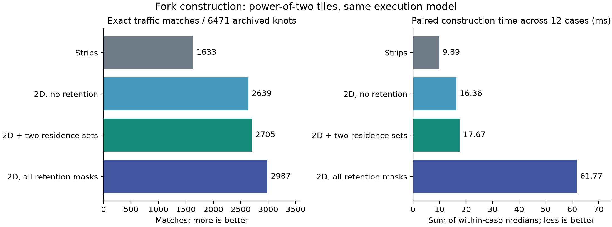

# Two-axis tiles and scoped retention: results on the experiment server

The new family recovers the known 137/133-byte reverse exception and five
additional midpoint capacity targets. A much smaller, analytically motivated
subset keeps those midpoint improvements while reducing construction time by
71.4% relative to all retention masks. **The subset is not frontier-equivalent**:
it loses other tradeoffs, including a worst 26.7% traffic excess relative to the
full new family. The useful result is an explicit cost/quality tradeoff and a
cost-preserving residence substitution, not a complete optimizer.

## What changed

`tiled_fork.py` finishes a two-dimensional tile of X, lets EU and EV consume it,
and then releases it. One subset of tensors may remain resident across the
inner tile loop. I-outer and K-outer orders have different legal retention
sets. Local vector/scalar kernel order is selected to reduce scratch without
changing per-tile traffic. No FFM call, recursive nest search, or reference
lookup occurs during construction.

The old constructor, curve model and independent simulator are unchanged.
Experiments retain the same abstract unit-byte, exact-integer, two-level-memory,
no-recomputation semantics. These are modeled storage/traffic results; no
hardware speedup, area optimum, or native FFM search improvement is claimed.

## Controlled ablation

All 256 archived shapes, both contraction patterns: 512 instances and 6471
archived capacity knots. The following table holds the power-of-two tile grid
fixed. Midpoint targets are exactly those from the preceding experiment, for
the 64 I=K shapes and both patterns. They were derived from half-row strips;
they are not an unbiased sample of hardware budgets.

| Family | Exact traffic at archived knots | Worse traffic | No fitting plan | Exact midpoint capacities | Median construction + frontier |
| --- | ---: | ---: | ---: | ---: | ---: |
| Old strips / whole X | 1633 | 3046 | 1792 | 116/128 | 0.783 ms |
| Add 2D tiles, no retention | 2639 | 3832 | 0 | 116/128 | 1.165 ms |
| Add 2D tiles + two residence alternatives | 2705 | 3766 | 0 | 121/128 | 1.280 ms |
| Add 2D tiles + all scoped retention masks | 2987 | 3484 | 0 | 121/128 | 3.849 ms |

“No fitting plan” concerns these constructors, not physical infeasibility.
Removing that category means producing executable candidates at those budgets,
not recovering their optimal traffic. No power-of-two constructor beats the
archived reference, including on the union of breakpoints.

Two-axis geometry provides most of the additional full-curve matches. Scoped
retention, not geometry alone, supplies the five additional midpoint matches.
The reduced family retains those five while omitting other useful masks.



The figure's right panel is a separate paired benchmark: all four modes run
in one process, with mode order rotated over 12 repetitions, on six shapes
and both patterns. Sums of within-case median times are:

| Old strips | No-retention 2D | Reduced retention | Full retention |
| ---: | ---: | ---: | ---: |
| 9.892 ms | 16.357 ms | 17.672 ms | 61.770 ms |

Reduced/full is 0.286, or **71.4% less construction time**. This includes
candidate construction and Pareto selection, excludes independent replay,
and is not an exact-search speedup: the two families have different coverage.
On the union of reduced/full breakpoints across all 512 instances, reduced
matches full at 6017 points and is worse at 362; worst relative traffic excess
is **26.7%**. The reduced family uses 78–192 candidates per instance, compared
with 198–684 for the full family.

## A concrete residence substitution

Let a row strip have width r and p=ceil(I/r). The old construction retains an
r×K tile of X, uses r+1 scratch cells, and has these exact transfer counts:

```
same:  Q = IJ + pJK + 2pKL + 2IL
cross: Q = IJ + pJK + (3p-1)KL + 2IL
```

An alternative retains A/U/V slices (same) or A/U/D slices (cross) throughout
the K loop. It produces X one column at a time, finishes each column's J
reduction before consumption, and retains only r cells of X. The permanent
slices use r(J+2L) cells; scalar scratch costs one. Thus:

```
retain X:                    S = r(K+1) + 1
retain operand/output slices: S = r(J+2L+1) + 1
```

All tensor read/write counts are identical between these two schedules.
Inputs make the same number of passes; same-pattern U/V finish within each
row strip, while cross-pattern V incurs the same inter-strip partial-sum
writebacks. Both avoid X DRAM traffic and recomputation. Ragged final strips
change p but not the largest strip's peak.

Therefore the better of these **two complete-fork constructions** has:

```
S_pair = r * (1 + min(K, J+2L)) + 1
```

The column analogue replaces K by I and retains B/C/D (same) or B/C/V (cross).
It likewise preserves traffic. The constructor can choose between the two
representations from dimensions, before executing or enumerating a complete
nest. The identity was checked on **15,360 pairs**, covering every integer
strip width of all archived shapes and both patterns.

This is a dominance rule between those two constructions, under the stated
complete-fork semantics. It is **not** a lower bound, a sufficient boundary
for arbitrary downstream graphs, or a proof that all other retention masks
can be removed. The reduced family's full-curve losses demonstrate that last
claim would be false.

## Reverse exception: recovered, then changed by tile grammar

For `(I,J,K,L)=(32,8,32,4)` and absolute traffic target 3840:

| Tile grid / family | Same capacity | Cross capacity |
| --- | ---: | ---: |
| Archived recursive nests, powers of two | 137 | 133 |
| Old strips, powers of two | 261 | 261 |
| New full scoped family, powers of two | 137 | 133 |
| New full scoped family, all integer widths | 103 | 120 |

The recovered same plan uses r=8, c=1 and retains A/U/V. Its peak is
A64 + U32 + V32 + X8 + B1 = 137, with traffic 2560. A cross witness uses
r=8, c=4 and retains A/U, attaining 133 and traffic 3840. It differs from the
archived cross witness but is independently executable; this is not a lookup
of a saved plan.

With nondivisor strips, same uses r=6, c=1 and A/U/V (103 bytes, traffic 3584).
Cross uses r=7, c=1 and A/U/D (120 bytes, traffic 3584). Thus the four-byte
reverse ranking is not invariant under tile grammar in this constructive
family. Neither 103 nor 120 is proven globally minimal over all schedules.

The earlier large separation `(32,4,32,16)`, target 3456, remains 529/1041 in
the power-of-two family and 529/1004 with integer widths. Adding scoped 2D
retention did not remove it within the tested family. This is still not a
universal lower-bound result.

## Remaining misses and wider-grid comparison

The seven remaining power-of-two midpoint misses are fully reported:

| Shape | Pattern | Target | Archived capacity | Full scoped family |
| --- | --- | ---: | ---: | ---: |
| 16,4,16,4 | cross | 576 | 169 | 197 |
| 32,4,32,4 | same | 1152 | 205 | 209 |
| 32,4,32,4 | cross | 1152 | 329 | 417 |
| 32,4,32,8 | cross | 1920 | 589 | 673 |
| 32,8,32,4 | cross | 1536 | 397 | 545 |
| 32,8,32,8 | cross | 2304 | 657 | 777 |
| 32,16,32,4 | cross | 2304 | 529 | 657 |

These families still omit deeper scope changes, DRAM-backed X and split
consumer groups. Do not interpret a miss as an infeasible physical mapping.

With all integer widths, reduced/full match 120 midpoint capacities and beat
one archived power-of-two target. At the archived capacity knots, reduced
matches 2581 and improves 682, while full matches 2748 and improves 691.
Improvement over the power-of-two archive mixes grammar expansion and search
coverage; it is not an isolated Graph algorithm advantage. Reduced/full have
9205 equal union points and 323 worse points, with worst traffic excess 14.3%.
Candidate counts grow to 112–2688 (reduced) versus 328–16960 (full).

## Validation and reproducibility

All experiments ran as the experiment server, Python 3.12.16. The original FFN
job and its checkout were not modified. Experimental code is independent of
native FFM, and requires only the existing cell simulator for validation.

- **1280** small 2D schedules: peak, per-tensor reads/writes, MAC coverage and
  numerical outputs all match. Four invalid tile/interface cases are rejected.
  A test replaces `metrics()` with a throwing function while execution succeeds.
- **7562** selected 2D plans replay successfully, executing **118,713,344 MACs**.
  This includes every retained power-of-two 2D plan and all wider-grid 2D plans
  improving the archived curve or old strips at union breakpoints.
- The reduced frontier contains **7079** distinct 2D plans across both grids.
  **7075** reuse exactly matching prior validated descriptors; **4** additional
  replays pass. The prior audit's SHA-256 is recorded. These counts overlap and
  must not be summed as independent unique plans.

Source commits: `f4f4c7dc` (original protocol, validation, three-way sweep and
full audit), `f1ac7c5a` (post-observation reduced subset and paired timing),
`c5ca4628` (reduced-frontier audit). The protocol explicitly distinguishes the
initial experiment from the follow-up after observing its results. No archived
shape is described as held out.

Run from the corresponding Git checkout with `PYTHONHASHSEED=0`:

```sh
python -B -m research.index_coupling.run_tiled_fork validate
python -B -m research.index_coupling.run_tiled_fork sweep
python -B -m research.index_coupling.run_tiled_fork audit
python -B -m research.index_coupling.run_tiled_fork dual_sweep
python -B -m research.index_coupling.run_tiled_fork benchmark
python -B -m research.index_coupling.run_tiled_fork audit_reduced --prior-audit /path/to/audit.jsonl
python -B -m research.index_coupling.summarize_tiled research/index_coupling/results/tiled_fork --plot
```

Raw results, summary and figures: [results/tiled_fork](results/tiled_fork/).
Remote originals: `~/graph_dse/runs/tiled-fork-f4f4c7dc/` and
`~/graph_dse/runs/tiled-reduced-f1ac7c5a/`. Independent replay uses
at most four workers; construction and paired timing are serial.
