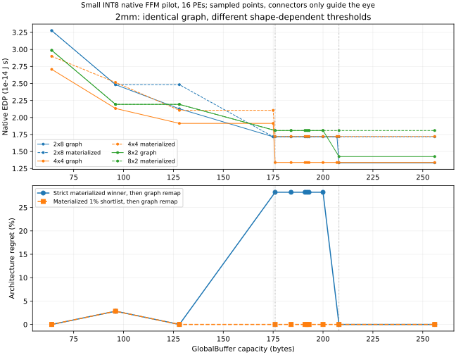

# Motivation pilot: can materialized mapping select the wrong hardware?

This experiment measures a specific selection error before proposing a new
optimizer. Native FFM evaluates the same hardware points under two mapping
contracts, then remaps the hardware selected by the restricted contract using
the graph-enabled reference. The question is the remaining **architecture
selection regret**, not the improvement obtained by remapping a fixed design.

This is a small native-mapper pilot, not the planned full-model motivation study.
It does not establish that real-world DSE workflows suffer the same loss.

## First verify what the baseline means

The [two-operator semantic probe](results/semantics.json) uses the existing
`matmuls.yaml`, M=4, KN=8, a 4×8 array, and 96 B GlobalBuffer. Its intermediate
T1 contains 32 B. Reconstructing and evaluating each selected mapping gives:

| Mode | T1 DRAM write | T1 DRAM read | EDP (native J·s) |
| --- | ---: | ---: | ---: |
| Default graph FFM | 0 B | 0 B | 1.9103744e-16 |
| Only `max_fused_loops=0` | 0 B | 0 B | 1.9103744e-16 |
| Zero fused loops + MainMemory `keep: All` | 32 B | 32 B | 2.50847232e-16 |

Thus **zero fused loops is not a DRAM-materialized per-operator baseline**.
Whole intermediates can remain on chip. The study uses the third contract for
the materialized baseline. It lets FFM optimize tiles and retain the E/latency
frontier through Join, rather than minimizing each operator's EDP separately.
MainMemory `keep: All` is a mapping restriction on the same hardware, not a
change in memory prices or capacity. Each materialized winner also replays at
the same E/latency on the default graph target.

## Initial architecture grid

- Existing native 2mm and 3mm YAML chains, M=8, KN=16, INT8. Each activation
  tensor is 128 B; these are small shape instantiations, not production models.
- Shapes 2×8, 4×4, 8×2, all 16 PEs; capacities 64, 96, 128, 192, 256 B.
- At each capacity both selection methods use all three shapes. Fixed native
  NVDLA action prices, bandwidth and zero leakage; no physical area model.
- Default graph FFM and explicit materialized FFM are independently searched
  at every point. All selected witnesses are reconstructed and evaluated;
  absolute-bit reservations are checked against capacity. The graph reference
  must not be worse than the materialized candidate at the same hardware.
  Replay uses AccelForge's own evaluator; it is an internal consistency and
  feasibility check, not independent validation of a hardware simulator.
- Reference means the best result returned by this declared native grammar
  and its enumeration policies, including default spatial min-usage rules.
  It is not a certificate over every physically possible mapping.

For materialized winner `a_L` and graph-reference winner `a_G`, measure
`C_graph(a_L) / C_graph(a_G) - 1`. All exact ties (relative tolerance 1e-9)
are retained and both best/worst tie outcomes reported. The table has unique
winners in every row.

| SRAM B | 2mm regret | 3mm regret | 2mm regret after 1% shortlist | 3mm regret after 1% shortlist |
| --- | ---: | ---: | ---: | ---: |
| 64 | 0% | 0% | 0% | 0% |
| 96 | 2.8275% | 0% | 2.8275% | 0% |
| 128 | 0% | 0% | 0% | 0% |
| 192 | 28.2552% | 17.0924% | 0% | 0% |
| 256 | 0% | 9.1572% | 0% | 0% |

The shortlist control keeps **all** shapes within 1% of the best materialized
score, graph-remaps them and selects the best. Its membership uses only the
materialized score; it is not selected by inspecting graph outcomes. A 5%
shortlist sensitivity is also saved. This is an additional baseline, not a
new proposed algorithm or a free operation: it requires those graph queries.



At 192 B, materialized 2mm selects 2×8, graph FFM selects 4×4. Both execute in
256 ns, but graph 4×4 avoids T1's 128 B write plus 128 B read. Native energy is
52.281344 nJ versus 67.053568 nJ on the remapped 2×8. However, materialized
2×8 is only about 0.268% better than materialized 4×4, so the 1% shortlist
eliminates the headline 28.26% regret. The large strict-winner regret is real
within this grammar, but fragile to a simple stronger selection baseline.

## Interpretation and remaining measurements

### Exploratory threshold refinement

After the initial grid, a three-shape sweep at 176, 184, 191, 192, 193, 200,
208 B found a flat region of strict-winner regret followed by recovery at
208 B. A targeted two-shape check at 175/176 and 207/208 B resolved two
different transitions. This was **post-hoc refinement**, not blind prediction
of a cliff location, and the smaller targeted grid is not mixed into the
three-shape selection table above.

| Shape and capacity change | Graph EDP change | T1 DRAM read+write | Actual mechanism |
| --- | ---: | ---: | --- |
| 4×4, 175 → 176 B | −30.0421% | 0 → 0 B | T0 reads 256 → 128 B; T2 reads 128 → 0 B and writes 256 → 128 B |
| 2×8, 207 → 208 B | −22.2993% | 256 → 0 B | Eliminate intermediate writeback and reload |

Both use the same graph and 128 B intermediate. Weight DRAM reads stay at
256 B per weight matrix in both transitions. The 4×4 cliff is therefore
**not** the onset of intermediate retention and not reduced weight reads.
The selected low-cost 4×4 mapping has a 128 B intermediate, a 32 B activation
tile and a 16 B weight tile, totaling 176 B. The analogous 2×8 producer needs
a 64 B activation tile, totaling 208 B. Native replay retains the actual
absolute-bit reservations to check these demands.

This distinguishes graph lifetime from the architecture-dependent local tile
working set. Cut tensor size alone cannot predict these two thresholds; a
mapping/resource model is required. These are byte-addressable abstract
capacities, not a claim about commercial SRAM macro increments or area cost.

### What the pilot supports

There is a reproducible architecture-ranking mismatch, and its traffic
mechanism can be inspected. This supports asking the selection question.
It does **not** yet motivate a sophisticated graph optimizer: most large
losses disappear after retaining near-ties, and the remaining 2mm loss at
96 B is only 2.83% in this grid.

The pilot does not measure physical SRAM area overhead at equal EDP. Memory
capacity changes do not change the fixed action prices; equal PE count also
does not prove equal physical area. The refinement is explanatory, not a
validated prediction from cut size, and cannot establish a general
graph-structure contribution from chains.
MobileNet-28, the GPT block, larger shapes and physically priced budgets remain
future measurements. The next study should preserve the shortlist control and
only claim a persistent selection problem if it survives that baseline.

## Reproduction and artifacts

Use the repository's native FFM environment through `research/runtime/run_windows.ps1`.
`./research/motivation/run_pilot.ps1` reruns all five main cases serially;
its `-Cases` argument selects a subset. Each case uses one FFM worker.
For example, from the repository root:

```powershell
./research/runtime/run_windows.ps1 -PythonArguments @('-m','research.motivation.native_study','--params','2,8,16','--shapes','2x8,4x4,8x2','--capacities','64,96,128,192,256','--modes','graph,materialized','--output','research/motivation/results/2mm_grid.json')
```

Change `--params` to `3,8,16` and the output name for 3mm. The semantic probe
uses defaults with `--output research/motivation/results/semantics.json`.
Raw JSON includes every native E/latency frontier, selected mapping structure,
per-tensor DRAM action counts in **bits**, reconstruction checks, generation and
Join timings, and peak process working set. Timing excludes validation replay.
Each search uses one worker, with alternating mode order and warm process/JIT
caches. Some independent pilot runs shared the host concurrently. These
single-pass times are execution records, not a cold-start or
amortization benchmark; initialization can dominate the first query.

```powershell
python -m research.motivation.summarize research/motivation/results/2mm_grid.json research/motivation/results/3mm_grid.json --output research/motivation/results/summary.json
python -m pytest -q research/motivation/test_study.py
python -m research.motivation.plot_pilot
```

The summary rejects incomplete checkpoints and graph-reference inconsistencies.
Six tests passed: tie and near-tie aggregation, incomplete/inconsistent
reference handling, the zero-loop semantic probe, materialized-boundary and
capacity checks across all saved grid points, and threshold traffic mechanisms.
These tests inspect saved native witnesses as well as the summary logic;
the separate native searches and replay checks generated those witnesses.
Outputs overwrite their named paths; use another path for exploratory reruns.
Logs are local ignored files; the structured results are the committed evidence.
