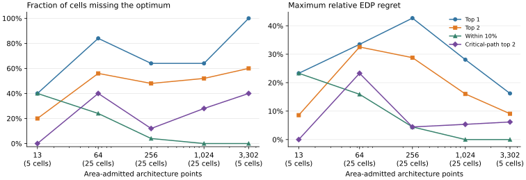

# Two-level SRAM and mixed-phase hardware gate

The gate tests one prefill projection and one single-query decode score
contraction. It uses 8-bit tensors and 2,048 MACs at 1 GHz. The two SRAM levels
hold shared data and stripe-private weights, respectively. The experiment
varies the PE geometry, global bank count, global capacity per bank, and
private capacity per stripe.

The [pinned CACTI run](https://github.com/HaoningJiang-space/accelforge-streaming-dse/actions/runs/42453899987)
characterizes 45 nm scratchpads with one dedicated read port and one dedicated
write port. The [macro table](results/sram_45nm.json) records area, dynamic
read and write energy, standby leakage, and access and cycle time. A stripe
has one private macro. The shared SRAM is built from separate global macros.
The budget covers these SRAMs. MAC and register counts are fixed, and
interconnect layout area is outside the model.

Native bit counts are prorated against 64-bit private and 512-bit global
transactions. The initial service model assumes evenly distributed global
bank traffic and rounds each bank's access and cycle times up to whole
1 GHz cycles. The one-bank sensitivity keeps all SRAM area and leakage
and limits the global service rate to one bank. Both modes use aggregate
service rates. Address-level bank calendars are outside this model.

The mapper generates native tile rows independently at each hardware point.
The EDP calculation adds the energy and time of both phases before
multiplying. The independent-hardware relaxation combines the full energy and
time fronts of both phases across the same area-capped hardware points.
Both architecture-first controls retain all ties and remap both phases
with the physical costs. One uses a fixed-price, zero-leakage proxy to choose
hardware. The other chooses hardware using only the prefill phase.

## Cold decode

The 512-token cold scan covered 15 hardware points across three area caps.
At 16, 64, and 256 decode steps, the shared-hardware penalties were 1.37%,
1.83%, and 2.00% at each cap. Prefill-first followed by full remapping tied
the shared optimum in all nine cases. The nine shared EDP values reproduced
exactly on Windows with the same CACTI table.
[Linux report](results/cold_512_linux.json.gz) ·
[Windows replay](results/cold_512_windows.json.gz)

## Resident decode

The 1,024-token variant allows the 64 KiB KV input to stay in GlobalBuffer
between decode steps. Each native tile reserves the whole tensor plus its
other live storage. The audit checks the bit-exact capacity and verifies
zero native DRAM reads of resident KV. An explicit DMA fill loads the full
input once after prefill. The fill occupies both endpoints and pays
DRAM read energy, SRAM write energy, and leakage during the transfer.

At the 1.3465 mm² SRAM cap, 13 hardware points are admitted and four
can keep KV resident. The 16-step shared winner uses a 32 × 64 array,
two 64 KiB global banks, and a 1 KiB private macro per stripe. It uses
1.0954 mm² of SRAM. In the all-bank model, prefill alone chooses a
16 × 128 array and four 16 KiB global banks. That hardware needs cold
decode because its GlobalBuffer has no room for both full KV and staging.

| Global service | Shared penalty at 16 steps | 64 steps | 256 steps | Prefill-first EDP ratio at 16 steps | Fixed-price remap ratio at 16 steps |
|---|---:|---:|---:|---:|---:|
| All banks | 7.39% | 4.73% | 1.94% | 5.86× | 1.00× |
| One bank | 8.12% | 4.85% | 2.68% | 3.46× | 1.00× |

The hardware-conflict threshold of 5% is met at 16 steps in both service
models. The fixed-price architecture selector also models residency and
ties the physical shared optimum in every resident case. The result
identifies a capacity threshold and shared-hardware cost. The matching
control leaves a search advantage open. The optimality scope is the
sampled native mappings.
[All-bank report](results/resident_1024_all_windows.json.gz) ·
[One-bank report](results/resident_1024_single_windows.json.gz)

The [Linux replay](https://github.com/HaoningJiang-space/accelforge-streaming-dse/actions/runs/42454657897)
regenerated the CACTI table byte for byte and reproduced all 27 shared and
independent EDP pairs and their shared winners exactly. The Linux native
scans took 39–45 seconds per service configuration.
[All-bank Linux report](results/resident_1024_all_linux.json.gz) ·
[One-bank Linux report](results/resident_1024_single_linux.json.gz)

## Run

Run these commands from the repository root in the AccelForge environment.

```sh
python -m research.physical_cost.cacti_sram /path/to/pinned/cacti /tmp/physical-cost
python -m research.physical_cost.mixed_gate /tmp/physical-cost/sram.json /tmp/cold.json
python -m research.physical_cost.mixed_gate /tmp/physical-cost/sram.json /tmp/resident.json --context 1024 --resident-kv
python -m research.physical_cost.mixed_gate /tmp/physical-cost/sram.json /tmp/single-bank.json --context 1024 --resident-kv --single-bank-service
```

On Windows, supply the corresponding Python arguments to
`research/runtime/run_windows.ps1` and use the checked-in macro table.
Raw run logs and CACTI inputs are available as a compressed workflow artifact.

## Addressed SRAM with two concurrent requests

The addressed experiment admits prefill after the first decode step of
another request and opens the next decode step after prefill staging
starts. It tracks 64-byte physical words in every global SRAM bank, charges
whole transactions, and schedules the separate read and write ports, a
single DDR port and a single MAC array. Prefill and decode have separate
fixed slots in the private weight SRAM of each stripe. Global slots are
reserved from the first fill until their final use. The decode request
can retain a full KV image or stream its weight slices from DDR.

The evaluator schedules commands and the independent replay enumerates
word addresses and their versions. The latter checks conflicts,
producer completion, peak occupancy and EDP. Both search families use
the same physical area, tile choices, schedules, and calibrated costs.
Each wall-clock trace starts with candidate generation and charges
architecture selection, event compilation, dispatch and verification of
each new incumbent. The common CACTI table is loaded before timing.

On the initial three cases, the shared winners held KV concurrently with
prefill staging for 8.762–16.246 µs. The bank-aware architecture selector
retained all exact ties and the wider control included all architectures
within 2% of its bound. Both matched the complete search in all three
cases. The initial grammar refetches the prefill weight tile per row tile.
[Initial Windows report](results/banked_v1_windows.json.gz)

```sh
python -m research.physical_cost.banked_search research/physical_cost/results/sram_45nm.json /tmp/banked.json.gz
python -m pytest -q research/physical_cost/tests/test_banked_serving.py
```

### Weight residency and capacity binding

The expanded grammar can keep each prefill weight stripe in private SRAM
across row tiles and reserve the full source strip in global SRAM until the
last local fill. All searches can use this mapping. At context 768, adding
this option reduces the best EDP by 47.0% relative to the initial grammar.

Mapping-first capacity binding groups hardware by PE shape, bank count
and per-bank service cycles. For each addressed layout it computes the
global and private capacity requirements once. Within a group it discards
a feasible macro configuration only when another feasible configuration
has no greater read, write or leakage cost at each level. Their addressed
transactions and dispatch times are identical. The grouped architecture
sweep has the same rule. It removes 112 feasible pairs per workload and
cuts median generation time by 18–28% relative to joint search without
binding. Both complete sweeps and both joint searches agree on EDP.

Seven cases were run locally on Windows, serially in rotating method
order, with three repetitions, 13 hardware points and a common SRAM area
limit of 1.346496 mm². The table reports final EDP normalized to capacity
binding and median cold time (including candidate generation). The
bank-aware architecture selector includes all ties; the near variant
also includes all points within 2% of its optimistic score. Both fully
remap the selected points using the addressed evaluator.

| Workload | Near selector EDP ratio | Separate phase selector EDP ratio | Binding time (s) | Near selector time (s) | Grouped complete sweep time (s) |
|---|---:|---:|---:|---:|---:|
| Context 512 | 1.1110 | 1.0000 | 0.350 | 0.282 | 0.403 |
| Context 768 | 1.0000 | 1.5934 | 0.311 | 0.333 | 0.311 |
| Context 1024 | 1.0000 | 1.0000 | 0.320 | 0.340 | 0.352 |
| Context 1536 | 1.0000 | 1.0000 | 0.597 | 0.586 | 0.598 |
| Asymmetric | 1.0000 | 1.0000 | 0.619 | 0.639 | 0.663 |
| Decode heavy | 1.0000 | 1.0000 | 0.311 | 0.329 | 0.310 |
| Prefill heavy | 1.0000 | 1.3014 | 0.338 | 0.309 | 0.302 |

At 0.5 s in each repetition on context 512, joint binding, joint search
and the complete sweeps returned the same best EDP. That EDP is 10.0%
below either bank-aware architecture selector. The separate-phase selector
also reaches the optimum after a median 3.365 s. The winning 64 × 32 array
uses four 16 KiB banks and 6.613 µs, while the bank-aware selector chooses
two 64 KiB banks on the same array and takes 7.726 µs. At 2 s the bank-aware
selectors still differ only on that case. End-to-end time gains from
binding vary by workload.

The independent replay finds 3.114–9.788 µs of KV and prefill staging
co-residence and 0.479–2.825 µs of cross-request read/write overlap summed
over banks. For a fixed context-768 tile and hardware, the striped,
separated and shared layouts have identical word counts, dynamic energy
and peak aggregate occupancy. Their scheduler bank-wait totals are
3.965, 5.013 and 10.357 µs, and their independently replayed makespans are
13.022, 13.519 and 17.832 µs. Bank placement alone changes executable
latency in this ablation.

The area cap covers CACTI SRAM macros with fixed total MAC count and DDR
bandwidth. The experiment covers one prefill GEMM and one decoder score
operator, uses fixed physical slots and two declared dispatch priorities,
and does not generate AccelForge native FFM address traces. Exactness is
within that finite grammar.

[Expanded Windows report](results/banked_v2_windows.json.gz)

### Wider shortlists and complete cache reservation

The shortlisted architecture-first remapper now also supports all points
within 10% of the best score and the top two points including all ties at
the cutoff. At the original cap and 512-token context, the joint EDP is
9.99% below the 10% shortlist and 7.90% below the top two at 0.5 s across
all three repetitions. The grouped complete sweep reaches the same EDP
under that budget. For three held-out contexts (448, 576 and 704) crossed
with two SRAM area caps (1.211846 and 1.481146 mm²), the top two reaches
the exact EDP in all six cells by 0.5 s. The 10% selector misses it only
at the higher cap and 576 tokens, where joint EDP is 18.89% lower.
[Shortlist result](results/banked_shortlist_512_windows.json.gz) ·
[Smaller cap holdout](results/banked_holdout_1.35_windows.json.gz) ·
[Larger cap holdout](results/banked_holdout_1.65_windows.json.gz)

The complete cache variant requires both K and V to be loaded into
different physical words of the same banked SRAM. V stays allocated
through the last measured decode step; an independent check verifies
all V word fills, completion before the first decode compute, and the
absence of an early release. Every search uses mandatory residency in
this variant. The timed decoder still executes QK scores; a subsequent
value contraction and KV updates are outside the experiment. V is
charged for its initial fill and leakage, and its storage competes with
prefill staging throughout the trace.

| Context | Allocated V | Total global SRAM peak | Full KV and prefill co-residence | Cross-request bank R/W overlap |
|---|---:|---:|---:|---:|
| 256 | 16 KiB | 90,432 B | 4.276 µs | 0.535 µs |
| 384 | 24 KiB | 106,816 B | 4.920 µs | 0.470 µs |
| 512 | 32 KiB | 123,200 B | 4.979 µs | 0.535 µs |

At the original cap the capacity binder and the grouped full sweep tie
all three complete-cache optima. All bank-aware shortlists also match
them by 0.5 s. The isolated-phase selector is worse on two of the three,
by 12.91% and 47.43% when measured as the reduction in EDP from the
selector to the joint optimum. These are differences against the
isolated selector; the complete-cache experiment does not establish a
search advantage over the bank-aware selectors.
[Complete-cache result](results/banked_complete_kv_windows.json.gz)

```sh
python -m research.physical_cost.banked_search research/physical_cost/results/sram_45nm.json /tmp/holdout.json.gz --area-factor 1.65 --cases holdout448 holdout576 holdout704 --methods binding near wide top_two grouped_sweep standalone
python -m research.physical_cost.banked_search research/physical_cost/results/sram_45nm.json /tmp/full-kv.json.gz --cases kv256 kv384 kv512 --methods binding optimistic near wide top_two grouped_sweep standalone
```

### Dependency and bank-port ranking control

The critical-path variants compile the four cheapest distinct mappings
per hardware point. Each probe uses the command DAG's longest path and
the busiest physical port to refine its mapping lower bound. Probe cost
is included in cold runtime and its compilation is reused for dispatch.
The architecture-first controls rank each point by the smallest refined
probe bound, keep either all first-place ties or the first two points
including cutoff ties, then fully remap. Joint search has access to the
same probes. The probe score only ranks architectures; any pruning uses
the certified bound of each individual mapping.

At context 768, the aggregate word counts of the fixed layout ablation
are identical. The inexpensive per-bank bound orders the three layouts
correctly, with shared placement only 13% above striping in predicted EDP.
The command bound raises that separation to 18%, but assigns shared and
separate placement the same bound. Addressed execution puts shared
placement 46% above striping. The command bound is a stronger
relaxation for these mappings, and it still misses contention.

The critical-path top two matches final joint EDP in all ten cells.
At context 512 it matches by 0.5 s in all three repetitions; using only
the cheaper top two still leaves a 7.90% gap. At the higher-cap
576-token holdout, the critical-path top two has 23.29% higher EDP than
critical-path joint search at 0.5 s and matches when allowed to finish.
The cheaper top two already matches by 0.5 s. The grouped full sweep
also matches final EDP throughout. With mandatory K and V residency,
the architecture-first controls and joint search match by 0.5 s in
all three cases. These comparisons establish bank placement and cache
lifetime effects without establishing a general optimizer advantage.

[Critical-path original and complete-cache results](results/banked_critical_1.5_windows.json.gz) ·
[Smaller cap results](results/banked_critical_1.35_windows.json.gz) ·
[Larger cap results](results/banked_critical_1.65_windows.json.gz)

```sh
python -m research.physical_cost.banked_search research/physical_cost/results/sram_45nm.json /tmp/critical.json.gz --cases context512 kv256 kv384 kv512 --methods binding critical_joint critical_first critical_two grouped_sweep top_two
```

## Architecture shortlist scaling

The scale experiment keeps one 2,048-MAC array and the same DDR service
model. It varies the array shape, the number of independent global SRAM
banks (2–24), and the macro type and depth in global and private SRAM.
Multiple identical macros behind the same logical port add capacity,
area and standby leakage. An access uses one macro and the model uses
its calibrated word energy and service period. Selection mux and
routing overhead are outside the area and timing model. The common
4.5 mm² SRAM cap admits 3,302 configurations, of which 2,391–2,715 are
feasible across the five workloads. They form 149 distinct timing
classes. Each class groups equal PE shape, bank count and rounded
global and private port cycles.

The compiler builds an addressed layout and optimistic profile once
per mapping and timing class. Within a class, a design can be removed
when another feasible design admits every mapping it does and has no
larger cost for any action or for standby leakage. Both designs run
each shared mapping with identical command times. This leaves 552–760
architecture points in the five full-grid cells. The experiment reports
fixed shortlist results on the entire feasible grid as well as after
this safe reduction. All fixed shortlists retain ties at the cutoff
and remap over the whole declared grammar.

For a shortlist with exact remapped EDP U and minimum omitted
architecture lower bound B, the global optimum lies in
[min(U, B), U]. The relative optimality gap is at most
U / min(U, B) - 1. In particular, B >= U certifies that the shortlist
contains an optimum. The architecture lower bound is the minimum of
the admissible bounds over all feasible mappings. Ranking by a handful
of command probes is heuristic and is used only to order the shortlist.
An adaptive baseline orders the remaining architectures by admissible
bound, remaps each until the remaining bounds cannot improve the
incumbent, and independently replays every reported winner.

The original 13-point pool is included in every subset. Five fixed
seeds generate nested 64-, 256- and 1,024-point subsets. The full grid
and the anchor each run once per workload. Each cell below is a
workload and subset pair. Entries show misses over cells, followed by
the maximum observed relative EDP regret. The table uses all feasible
points and the exact same evaluator throughout.

| SRAM grid size | Cells | Top 1 | Top 2 | Within 10% | Critical-path top 2 |
|---|---:|---:|---:|---:|---:|
| 13 | 5 | 2/5 (23.29%) | 1/5 (8.58%) | 2/5 (23.29%) | 0/5 (0.00%) |
| 64 | 25 | 21/25 (33.47%) | 14/25 (32.53%) | 6/25 (15.91%) | 10/25 (23.29%) |
| 256 | 25 | 16/25 (42.68%) | 12/25 (28.79%) | 1/25 (4.43%) | 3/25 (4.43%) |
| 1,024 | 25 | 16/25 (28.09%) | 13/25 (16.03%) | 0/25 (0.00%) | 7/25 (5.35%) |
| 3,302 | 5 | 5/5 (16.21%) | 3/5 (9.08%) | 0/5 (0.00%) | 2/5 (6.18%) |

The miss fraction is nonmonotonic. At 3,302 points the 10% window
includes 24–80 feasible designs per workload (22–54 after the safe
reduction) and finds every optimum in this sample. Its omitted lower
bounds do not certify any of those five choices. The exact adaptive
solver certifies the full grids by remapping 54–148 architectures
after reduction. The two largest-grid critical-path misses are 3.95%
regret on context 576 and 6.18% on the 32-step complete-cache case.
Their winners agree with the word-address replay. All values refer
to the banked prefill-GEMM/QK grammar. The diagnostic shares work
across nested subsets, so its aggregate runtime is not a cold
comparison of search methods.

[Scale report](results/banked_scale_450_windows.json.gz)

```sh
python -m research.physical_cost.banked_scale research/physical_cost/results/sram_45nm.json /tmp/scale.json.gz
```

The plot summarizes the same nested cells. Each size labels its number
of workload/subset pairs. Shared anchor points and nested seeds make
these descriptive frequencies.



```sh
python -m research.physical_cost.plot_banked_scale research/physical_cost/results/banked_scale_450_windows.json.gz /tmp/scale.svg
```

### Cold search at 3,302 architecture points

The cold comparison regenerates the grid, mapping profiles and safe
dominance reduction for every run. Each method begins with the same
verified feasible seed. The adaptive method opens complete remaps in
order of architecture lower bound. The joint method interleaves
mappings across architectures and lazily refines their bounds with the
command DAG. The two fixed shortlists fully remap their selected
architectures. Every improvement is checked by the independent word
replay before its timestamp is recorded. Five repeats rotate the method
order. Timing starts before grid construction and includes selection,
compilation and verification. The precomputed CACTI characterization
table is shared.

| Workload | Method | Median time to exact EDP | Median total time (range) | Schedule checks | Final regret | Certified |
|---|---|---:|---:|---:|---:|---|
| Context 576 | Adaptive | 4.536 s | 6.429 s (6.329–6.933) | 166 | 0% | Yes |
| Context 576 | Joint | 5.637 s | 6.222 s (5.748–7.055) | 150 | 0% | Yes |
| Context 576 | Within 10% | 4.492 s | 5.260 s (5.205–6.688) | 128 | 0% | No |
| Context 576 | Critical-path top 2 | — | 12.458 s (12.275–13.769) | 12 | 3.95% | No |
| 32-step K+V | Adaptive | 3.128 s | 8.401 s (8.101–8.986) | 544 | 0% | Yes |
| 32-step K+V | Joint | 4.466 s | 9.251 s (9.005–9.357) | 544 | 0% | Yes |
| 32-step K+V | Within 10% | 3.136 s | 6.209 s (6.131–6.321) | 230 | 0% | No |
| 32-step K+V | Critical-path top 2 | — | 18.255 s (18.164–18.939) | 32 | 6.18% | No |

In context 576, the adaptive baseline reaches the exact EDP at the
5-second checkpoint in 5/5 runs, the 10% window in 4/5, and joint
search in 0/5. The first three methods reach it in all five long-cache
runs at 5 seconds. The critical-path selector spends most of its time
compiling candidates for architecture ranking. Those compilations
are included in total time and separately reported. The joint search
reduces schedule checks in one case and reaches the optimal EDP later
in both. The 10% policy attains that EDP with no global certificate.

[Cold comparison](results/banked_scale_cold_450_windows.json.gz)

```sh
python -m research.physical_cost.banked_scale research/physical_cost/results/sram_45nm.json /tmp/scale-cold.json.gz --cases holdout576 kv_long --cold-repeats 5
```

### Certifying the omitted architectures

Both certifiers start with the exact remapped 10% shortlist, its
verified incumbent, and copies of the same command and schedule
caches. They must exclude every remaining architecture. The
architecture certifier remaps by lower bound. The family certifier
groups feasible mappings with identical addresses, dependencies and
service periods. At a fixed mapping and duration it takes the minimum
EDP across the actual feasible members, using each member's dynamic
energy and leakage. A family can be rejected when this minimum at the
command latency bound reaches the incumbent. Otherwise it uses the
faster of the two addressed schedules and checks the member costs
at that duration. Identical timing allows one dispatch to cover
all members with the same priority, while capacities and prices
are evaluated per member.

All five incumbents were certified by both methods in all repeats.
These times start after shortlist remapping. The new work columns
are identical for both methods because the architecture baseline
already caches equivalent command timings.

| Workload | Omitted designs after dominance | New compilations | New schedules | Architecture median (s) | Family median (s) |
|---|---:|---:|---:|---:|---:|
| Context 512 | 713 | 164 | 6 | 1.152 | 1.164 |
| Context 576 | 712 | 164 | 20 | 1.296 | 1.322 |
| Complete K+V | 536 | 134 | 0 | 0.917 | 0.997 |
| 32-step K+V | 563 | 172 | 272 | 2.658 | 2.834 |
| Asymmetric K+V | 498 | 106 | 6 | 1.496 | 1.491 |

The long-cache case has 314 vs 288 logical schedule checks with
identical physical dispatch counts. This comparison establishes a
practical certificate for the 10% window. Batching the proof by
timing family adds no measured reduction in new addressed evaluations.

[Certificate comparison](results/banked_scale_proof_450_windows.json.gz)

```sh
python -m research.physical_cost.banked_scale research/physical_cost/results/sram_45nm.json /tmp/scale-proof.json.gz --proof-repeats 5
```

## Scaling timing classes with DDR and PE count

The addressed evaluator now gives the DDR port a configurable integer
service time per 64-byte word. The four settings are 1, 2, 4 and 8 ns,
or effective rates of 64, 32, 16 and 8 GB/s. The DMA and global bank
occupy the slower of their two service periods. The analytic bound,
command evaluator and independent word replay use the same setting.
The PE counts are 1,024, 2,048 and 4,096. Each panel enforces a separate
MAC ceiling and a CACTI SRAM area cap. MAC area and DDR interface area
are outside that SRAM budget, and per-word DDR energy is held fixed.

The timing key includes the PE X axis, the two actual Y-axis fold
counts for the prefill and decoder reductions, the bank count and
the global, private and DDR service periods. This merges nominal
PE geometries when both reductions are saturated. Capacity and
action prices remain design-specific. Safe dominance is applied
separately at each area cap before architecture best-first remapping.
The tests compare cross-DDR and cross-PE schedule reuse with an
unpruned enumeration and the independent word replay.

For fixed 32 GB/s, the following cells show effective classes,
opened classes and classes where the search actually dispatches at
least one addressed schedule. A class is opened when the architecture
bound is too low to dismiss its remap before considering its mappings.

| Workload | 1.35 mm² effective / opened / dispatched | 2.70 mm² effective / opened / dispatched | 4.50 mm² effective / opened / dispatched |
|---|---:|---:|---:|
| Context 576 | 63 / 8 / 3 | 198 / 64 / 32 | 378 / 96 / 44 |
| 32-step K+V | 45 / 6 / 4 | 189 / 28 / 23 | 378 / 65 / 40 |
| Asymmetric K+V | 33 / 6 / 4 | 189 / 56 / 33 | 378 / 79 / 44 |

At 4.5 mm², each of the four fixed-DDR panels has 378 effective
classes and the adaptive proof opens 21–96 of them (5.6–25.4%).
The combined envelope at that cap admits 39,624 SRAM designs, with
1,788 nominal and 1,512 effective timing classes in each workload.
It opens 46–86 classes. All three combined winners use the fastest
DDR setting. The fixed-DDR panels keep that bandwidth effect out of
their denominators. The proportion of opened classes varies with
workload, area and DDR speed. The report records both the architecture
and timing-class counts, including how many bounds remain strictly
below the verified final incumbent. These are search-work counts.
The diagnostic shares profile construction across panels.

[DDR and PE scaling report](results/banked_axes_windows.json.gz)

```sh
python -m research.physical_cost.banked_axes research/physical_cost/results/sram_45nm.json /tmp/axes.json.gz
```

## Native FFM check with AV and FFN

The native probe loads the AccelForge GPT-3 block example with eight
tokens, width 64, four 16-wide heads and FFN width 256. It includes
the input copy, Q/K/V projections, QK, the example's elementwise
softmax proxy, AV, output projection and both FFN GEMMs. FFM generates
and joins mappings independently at each of five SRAM-admitted
architectures. Fusion is capped at one loop. The best joined
energy/latency row is replayed through AccelForge evaluate_mapping
and the two values must agree before reporting the leakage-adjusted
EDP. This uses the native aggregate memory model. KV append and
address-level overlap are outside this probe.

The compute-only lower bound uses compulsory contraction MACs,
ideal utilization of the chosen array and nonnegative SRAM leakage.
The five architectures all required remapping. The best EDP is
6.762e-12 J s on the 32 × 128 array with four 16 KiB global banks
and 64 GB/s DDR. The bound agreed with the exhaustive architecture
result. Every FFM frontier contained one row and replay matched
energy and latency at all five points. The timings are smoke-run
diagnostics for the declared block and fusion limit.

[Native compute-bound report](results/native_block_compute_windows.json.gz)

The cold DDR cut also charges the six compulsory external projection
and FFN weight reads. MainMemory is their backing store in this
specification. The bound adds their bit energy to mandatory MAC
energy and uses the maximum of ideal array service and required
single-DDR read service. SRAM standby leakage is charged over
that latency bound. Intermediate activations, output writeback,
and startup costs are relaxed. The replay explicitly checks each
of the six weights and finds 393,216 read bits (48 KiB) on every
architecture.

The cold cut opens four of the five architectures. It eliminates
the 16 GB/s point with a lower bound of 9.283e-12 J s after finding
an incumbent of 6.762e-12 J s. The independent full remap of the
excluded point gives 1.814e-11 J s. The three architectures with
fixed 32 GB/s all still require remapping. The elimination is
specific to the mixed DDR pool. This probe uses FFM's native
bit-granular aggregate memory model and the same graph and
fusion limit as the compute-only check.

[Native cold DDR report](results/native_block_cold_cut_windows.json.gz) ·
[Original FFM paper](https://arxiv.org/abs/2602.15166)

```sh
python -m research.physical_cost.native_block research/physical_cost/results/sram_45nm.json /tmp/native-block.json.gz --cold-ddr-bound
```

## Joint area budget with paid DDR and MAC choices

This sweep charges one common budget for the two SRAM levels, the
MACs, and the DDR I/O and digital PHY area estimate. The SRAM
entries are the existing 45 nm CACTI table. For the INT8 PE, Yosys
0.61 synthesizes the registered multiply and signed 32-bit accumulator.
Generic gates and mapped flops are priced using the pinned Nangate45
X1 cell areas. The sum is 1,180.508 µm² per PE. This is standard cell
area before routing and clock implementation.

DDR I/O area and read, write and idle power come from the pinned
CACTI external I/O routines with one loaded rank per channel.
The additional digital PHY area is the modeled I/O area times
0.551 / 3.820, the digital-to-I/O ratio of the published DDR3
controller. This ratio is a proxy for the digital part of the DDR4
design. DDR4-2000 channel replication represents 8, 16 and 32 GB/s.
The 64 GB/s point uses five 32-bit DDR4-3200 channels. The scheduler
still represents their aggregate bandwidth as one shared port.

| DDR (GB/s) | I/O + digital PHY (mm²) | Read (pJ/bit) | Write (pJ/bit) | Idle (mW) |
|---|---:|---:|---:|---:|
| 8 | 1.810 | 14.792 | 16.152 | 57.361 |
| 16 | 2.907 | 12.874 | 14.233 | 63.121 |
| 32 | 5.815 | 12.874 | 14.233 | 126.242 |
| 64 | 10.535 | 10.712 | 11.744 | 325.686 |

Transfer energy is active minus idle power divided by aggregate bit
rate. Idle interface power is charged once over elapsed execution
time. Replicating identical channels preserves incremental pJ/bit
and increases area and idle power. The nominal energy estimate uses
the modeled interface. At 32 GB/s its active price already exceeds
the old fixed 7.03 pJ/bit, so the residual DRAM core energy is zero
in the nominal ledger. The optional device term permits sensitivity
analysis. Controller logic, package, array routing and PE idle power
are outside this model.

Each total-area cap adds 1.35, 2.70 or 4.50 mm² to the area of
the 2,048-MAC and 32-GB/s reference without SRAM. Those same
9.582, 10.932 and 12.732 mm² limits apply to every hardware choice.
The three workloads all choose 32 GB/s at each limit. The winning
MAC count varies between 1,024 and 4,096. The 64 GB/s tier is
infeasible at the first two limits. At the last it admits only
1,024-MAC designs and still loses wherever a mapping fits.

The fixed 32 GB/s panel gives the following numbers of opened
versus effective timing classes.

| Workload | 9.582 mm² | 10.932 mm² | 12.732 mm² |
|---|---:|---:|---:|
| Context 576 | 40 / 94 | 64 / 195 | 80 / 318 |
| 32-step K+V | 15 / 86 | 41 / 192 | 67 / 317 |
| Asymmetric K+V | 40 / 81 | 28 / 192 | 67 / 315 |

At the largest cap, the fixed 32 GB/s proof opens 21.1–25.2% of
classes. At smaller caps it can open up to 49.4%. The report records
actual dispatch separately. The counts describe this model and these
sizes. The mixed-DDR denominator includes service classes with very
different bandwidth, and no asymptotic claim follows from the sweep.

[Raw calibration ledger](results/paid_ledger.json) ·
[Paid-area scan](results/paid_area_windows.json.gz) ·
[CACTI-IO](https://users.cs.utah.edu/~rajeev/cacti7/) ·
[Controller area table](https://kluedo.ub.rptu.de/files/8310/Diss_Chirag_Sudarshan_wo_DOB.pdf)

```sh
# Use the revisions and Liberty hash in results/paid_ledger.json.
yosys -p 'read_verilog mac_int8.v; synth -top mac_int8 -noabc; dfflibmap -liberty nangate.lib; write_json mac.json; stat'
g++ -std=c++11 -O2 -I "$cacti" ddr4_probe.cc "$cacti/extio.cc" "$cacti/extio_technology.cc" -o ddr4_probe
# Run from the repository root after producing the local probe and netlist.
python -m research.physical_cost.calibrate_ledger /tmp/mac.json /tmp/nangate.lib /tmp/ddr4_probe /tmp/ledger.json
python -m research.physical_cost.paid_area research/physical_cost/results/sram_45nm.json research/physical_cost/results/paid_ledger.json /tmp/paid-area.json.gz
```

At fixed 12.732 mm² and context 576, scaling only the interface area
by 0.8 selects 64 GB/s and 2,048 MACs, with 17 of 1,324 mixed
effective classes opened. Scaling it by 1.2 selects 32 GB/s and
2,048 MACs, with 84 of 1,058 opened. The nominal winner is 32 GB/s
and 4,096 MACs. A 4 pJ/bit incremental device term at nominal
area keeps that winner and changes fixed 32 GB/s openings from
80 to 83 of 318. The bandwidth conclusion depends on the PHY
estimate. Each sensitivity holds the absolute area limit fixed.

[PHY ×0.8](results/paid_phy080_windows.json.gz) ·
[PHY ×1.2](results/paid_phy120_windows.json.gz) ·
[DRAM device sensitivity](results/paid_device4_windows.json.gz)

## Historical native prefill and decode with PHY area charged

All three candidates run at 32 GB/s and fit the same 12.732 mm²
budget. They have 1,024, 2,048 and 4,096 MACs and respectively 768,
576 and 256 KiB of global SRAM. The candidates use the largest
number of 64 KiB banks within this cap for each shape, with
32 private 1 KiB SRAMs. Total areas are 12.378, 12.309 and
12.597 mm².

Native FFM remaps a 256 × 256 × 256 prefill projection and a
single-query attention graph with QK, the elementwise normalization
proxy and AV. The decode graph operates on a fixed four-head group
with 16 values per head. The episode runs prefill and decode in
series on the same hardware. The decode reuses the fixed K/V
inputs across autoregressively ordered queries. The model allows
either cold DDR reads each time or a complete cache reservation
with one charged fill. The resident case removes the full K/V
size from staging and retains the native mapper's active tile
reservations in the remaining space. Every joined frontier row
is replayed, including the per-tensor DDR action counts. Resident
K/V has zero off-chip reads after the initial fill. Fusion is
limited to one loop. This is a native aggregate model of a
fixed-context episode. It excludes concurrent requests, cache
append and partial residency from the mapped candidates.

The 4,096-MAC prefill takes 6.144 µs, compared with 16.384 µs
on 1,024 MACs. At context 5,120 only the latter can reserve
the 640 KiB cache. Its resident decode takes 24.320 µs per step.
Cold decode takes 42.244 µs per step. The shared optimum switches
at longer decode phases. The independent-hardware comparator
minimizes the product of summed energy and latency over both
complete phase frontiers.

| Context | Decode winner at 8 steps (MACs) | Shared hardware EDP penalty at 8 steps | At 32 steps | At 128 steps |
|---|---:|---:|---:|---:|
| 4,096 | 2,048 | 2.85% | 0.87% | 0.23% |
| 5,120 | 1,024 | 9.04% | 2.61% | 0.68% |
| 6,144 | 4,096 | 0% | 0% | 0% |

The last case has no room for both a complete cache and staging
on any candidate. At one decode step the prefill and decode
winners agree in all three contexts.

The boundary lower bound charges native compulsory input and
output activation traffic, including the prefill X read and P
write (64 KiB each). It also charges required weight reads and
uses the maximum of ideal compute and compulsory DDR service.
The capacity relaxation gives K/V all modeled on-chip storage
at a step boundary, including private SRAM and registers. If the
cache exceeds that capacity, the excess must be fetched before
each subsequent complete scan. The initial cache fill is charged
once. Intermediate scores and other internal activations can
stay on chip for free in the bound.

We compare both bounds against full native remapping of the
three architectures. The lower bound that assumes cold or fully
resident modes opens one of three at context 5,120 and 32 or
128 steps, and two at eight steps. The relaxed capacity bound
allows arbitrary partial residency and opens all three. These
are proof-work counts reconstructed from the verified frontiers.
The restricted-mode result does not establish pruning for
native partial caching or for arbitrary attention graphs.

[4,096 context](results/paid_native_4096_windows.json.gz) ·
[5,120 context](results/paid_native_5120_windows.json.gz) ·
[6,144 context](results/paid_native_6144_windows.json.gz)

The timings and shared penalties above describe the legacy mapping and
area/energy ledger at revision `e563bc4b`. The rerun below supersedes
that decode timing when interpreting the KV-capacity tradeoff.

```sh
python -m research.physical_cost.paid_area research/physical_cost/results/sram_45nm.json research/physical_cost/results/paid_ledger.json /tmp/paid-sensitivity.json.gz --cases holdout576 --caps 12.732443088031802 --phy-scale 0.8
```

## Native decode timing audit and fixed-bandwidth rerun

At context 5,120 on the 32 × 32 HP architecture at 32 GB/s,
QK and AV already each use 512 spatial instances in the legacy
plan. The pointwise normalization proxy has no spatial loop.
It processes 20,480 elements at one per ns. In the legacy cold
plan, QK and AV each take 10.882 µs at MainMemory and the
normalization takes 20.480 µs at MAC. This accounts for all
42.244 µs. The action counts show one full scan of K and V,
320 KiB each. Scores and Prob each make a 20 KiB write and
read, totaling another 80 KiB. That traffic explains the
23.044 µs summed DDR service. The normalization's legacy
1.280 µs DDR service fits inside its 20.480 µs MAC time.

The `spatial` ablation permits partitioning the normalization
input and output on the existing two fanouts. The `gemv` variant
also lets FFM choose whether to spill Scores and Prob. The
contractions retain their broadcast axes and existing reduction
paths. All joined plans are replayed with their action counts and
per-operator service times. An independent calculation from the
replay records reconciled exact DDR traffic and summed stage
maxima for all 32 decode plans.

| Mapping at 5,120 | Cold (µs/step) | Resident (µs/step) | Scores and Prob DDR traffic |
|---|---:|---:|---:|
| Legacy | 42.244 | 24.320 | 80 KiB |
| Spatial only | 23.044 | 5.120 | 80 KiB |
| Spatial and optional spills | 20.511 | 3.867 | 0 |

In the corrected cold plan, the two DDR stages take 10.242 µs
each and on-chip normalization takes 0.027 µs. Cold is within
0.15% of the raw 20.480 µs K/V transfer time in this aggregate
model. DDR command timing and first-block startup would need a
controller trace to establish attainable latency. In the resident
plan, QK and AV are limited by WeightBuffer service at 1.280
and 2.560 µs. This raises effective useful QK+AV throughput
over the whole decode step from 26.9 to 169.5 MAC/ns. These
resident timings exclude the one-time fill. Its cost is included
in episode EDP using balanced stripes and aggregate streaming service.

Bandwidth is a fixed system condition in each panel. The native
area cap is 6.918 mm² for SRAM and MACs. The three HP shapes
use 12, 9 and 4 global banks. PHY transfer and idle energy remain
in the ledger. The incremental DRAM core charges are 6.852
pJ/bit for reads and 5.554 pJ/bit for writes, derived from x8
DDR4 burst currents and full-row amortization of ACT/PRE.
Total active prices at 32 GB/s are about 19.73 and 19.79 pJ/bit.
The core model assumes the row amortization in the fixture
and excludes device refresh, additional device background
energy and controller queuing. MAC area retains the earlier
`synth -noabc` calibration. [DRAMPower DDR4 VDD fixture](https://raw.githubusercontent.com/tukl-msd/DRAMPower/master/tests/tests_drampower/resources/ddr4.json)

| Context, HP at 32 GB/s | Cold, 1,024 MACs (µs) | Resident, 1,024 MACs (µs) | Shared EDP penalty at 8 / 32 / 128 steps |
|---|---:|---:|---:|
| 4,096 | 16.409 | 3.093 | 7.63% / 3.72% / 1.31% |
| 5,120 | 20.511 | 3.867 | 28.16% / 12.39% / 3.99% |
| 6,144 | 24.612 | Infeasible | 0% / 0% / 0% |

The shared penalty compares one architecture with an idealized
pair of independently chosen architectures, each under the same
area cap. At 5,120 and 8 steps the 4,096-MAC prefill preference
and the 1,024-MAC resident decode preference persist at 16,
32 and 64 GB/s. The respective penalties are 11.60%, 28.16%
and 41.77%. The same ledger and architecture give an 8.40%
penalty with the legacy mapping at 32 GB/s. At 6,144 the largest
global SRAM has no staging after reserving all K/V.

The [45 nm LSTP table](results/sram_45nm_lstp.json) was generated
from the same CACTI revision with cell and peripheral device
types changed. A 64 KiB macro has 0.0194 mW leakage, versus
93.42 mW for HP. The area is 0.4827 versus 0.4259 mm² and
the modeled service takes three versus one ns. Remapping under
the same 6.918 mm² cap gives 11, 8 and 3 banks on LSTP. At 5,120
and 32 GB/s, the 1,024-MAC resident step changes from 3.867 µs
and 6.259 µJ to 4.087 µs and 2.425 µJ. The preferred prefill
shape becomes 2,048 MACs. At 8 / 32 / 128 steps the corresponding
shared penalties are 14.85% / 6.16% / 1.97%. This sensitivity
recharacterizes the entire SRAM, including its timing and area.
CACTI characterizes a single one-read/one-write bank. The area
and leakage ledger multiplies by the exact count of instantiated
macros. The native GlobalBuffer service model assumes balanced
traffic across those instances and excludes interconnect costs.

With both technologies fixed to 11 / 8 / 3 global banks, the
32 × 32 resident decode step at 5,120 and 32 GB/s gives the
following comparison. Standby includes the same PHY idle
power. This control keeps bank counts, capacity and ports
fixed while the MAC+SRAM area differs. Both fit the cap.

| Device | MAC+SRAM area (mm²) | Latency (µs) | Dynamic (µJ) | Standby (µJ) | EDP (µJ·µs) |
|---|---:|---:|---:|---:|---:|
| HP | 6.137 | 3.869 | 1.244 | 4.656 | 22.829 |
| LSTP | 6.762 | 4.087 | 1.908 | 0.517 | 9.911 |

The LSTP per-step EDP is 56.59% lower. The complete prefill
plus eight-decode-step episode EDP is 26.94% lower after
remapping, with the initial KV fill included.

At context 5,120 and 32 GB/s the partial-cache relaxation opens
two of three HP architectures at 8, 32 and 128 steps. The
declared cold/full-resident bound opens one. The work counts
are reconstructed from full remaps. The episode uses a
pointwise normalization proxy, three shapes and serial phases.
The shared penalty measures hardware conflict for those phases.
Partial-resident mappings, true softmax, KV append, concurrent
requests and optimizer comparisons require a different experiment.

[HP 4,096](results/decode_hp4096_windows.json.gz) ·
[HP 5,120](results/decode_hp5120_windows.json.gz) ·
[HP 6,144](results/decode_hp6144_windows.json.gz) ·
[Legacy](results/decode_legacy5120_windows.json.gz) ·
[Spatial-only](results/decode_spatial5120_windows.json.gz) ·
[16 GB/s](results/decode_bw16_windows.json.gz) ·
[64 GB/s](results/decode_bw64_windows.json.gz) ·
[LSTP](results/decode_lstp5120_windows.json.gz) ·
[HP with matched banks](results/decode_hp_matched5120_windows.json.gz)

The separate banked sweep uses the same per-bandwidth ledger.
At the 6.918 mm² cap the certificate opens the following timing
classes. Dispatch counts are recorded separately in the raw data.

| Workload | 16 GB/s | 32 GB/s | 64 GB/s |
|---|---:|---:|---:|
| Context 576 | 116 / 318 | 84 / 318 | 55 / 318 |
| 32-step K+V | 113 / 317 | 66 / 317 | 62 / 317 |
| Asymmetric K+V | 63 / 315 | 73 / 315 | 29 / 315 |

[Fixed-bandwidth banked sweep](results/fixed_ddr_windows.json.gz)

```sh
python -m research.physical_cost.cacti_sram "$cacti" /tmp/lstp --device itrs-lstp
python -m research.physical_cost.native_serving research/physical_cost/results/sram_45nm.json research/physical_cost/results/paid_ledger.json /tmp/decode.json.gz --context 5120 --bandwidth 32 --mapping gemv
python -m research.physical_cost.native_serving research/physical_cost/results/sram_45nm.json research/physical_cost/results/paid_ledger.json /tmp/decode-matched.json.gz --context 5120 --bandwidth 32 --bank-counts 11 8 3
python -m research.physical_cost.external_ddr research/physical_cost/results/sram_45nm.json research/physical_cost/results/paid_ledger.json /tmp/fixed-ddr.json.gz
```

## Concurrent attention with growing KV

The addressed evaluator runs one tiled prefill projection and two
autoregressive attention requests with independent arrival times.
Each decode step computes Q, K and V, appends the new KV position,
then attends to the full updated sequence. Cold append writes
through to DDR. Resident append writes SRAM and persists the new
positions to DDR before the episode ends. The mapping can choose
residency separately for each decode request, shared or partitioned
banks, staging depth, tile sizes, request priority, and stable
dense or online softmax. The online version keeps a maximum,
normalizer and weighted output per head between tiles.
[FlashAttention](https://proceedings.neurips.cc/paper/2022/hash/67d57c32e20fd0a7a302cb81d36e40d5-Abstract-Conference.html)

The evaluator reserves explicit SRAM word ranges and schedules each
bank's one read and one write port. DDR timing uses one DDR4-2400R
x64 rank with open rows, 64-byte bursts, bank groups, refresh and
turnaround. A separate replay checks the emitted commands against
the pinned Ramulator timing specification, verifies the SRAM
intervals and data versions by physical address, checks every
step's K and V scan range, and reconstructs EDP. A closed-row
read issues ACT at cycle 0 and RD at cycle 16. Its first and
last data boundaries are 26.656 and 29.988 ns. The validator
rejects a read issued one cycle early and checks another 5,000
mixed requests, including row conflicts and refresh. Numerical
comparison to a stable NumPy reference over growing contexts
gives a maximum absolute error of 1.78 × 10⁻¹⁴ in FP64.
[Ramulator DDR4 specification](https://github.com/CMU-SAFARI/ramulator2/blob/7bead6cb7c4b03e095c6d4769ae3181a8e0bf6da/python/ramulator/dram/ddr4.py)

The paired layouts use the same 16 × 64 array, six 16 KiB
banks, online softmax and one resident decode cache. The two
plans have equal action counts, dynamic energy (14.134 µJ) and
peak live SRAM (28,288 bytes). Striping completes in 16.196 µs
and partitioning in 17.058 µs. Partitioning reduces cross-request
port waits from 181 to 88 but allocates fewer service ports to
each request. Its busiest read port is occupied for 1.068 µs,
compared with 0.674 µs with striping. The striped trace has 1.405 µs of simultaneous
prefill staging and resident KV. The replay checks 16 placements
across both softmax forms and all four residency combinations.

The fixed 6.918 mm² MAC+SRAM cap admits 233 architectures.
The grid varies array dimensions, MAC count, bank count and
bank capacity. Each method starts from the same space of 33,054
feasible hardware-mapping pairs in the first two workloads and
26,274 in the pressure workload. Both types of search rank candidates
with the same proxy using whole-episode traffic and feasible
placements, and score them with the same addressed evaluator.
Architecture-first keeps every architecture tied at a shortlist
boundary and remaps each selected architecture in full when time
permits. The complete method can open the entire grid. The probe
variant measures one mapping for each of the first eight ranked
architectures, including ties, then ranks those architectures by
the measured result and resumes complete remapping. It retains
the rest of the grid. Interleaved search orders individual
architecture-mapping pairs across the same space.

Every run starts cold. The wall-clock budget includes the grid,
ranking, mapping generation and fine evaluation. The tables use
the best EDP from evaluations completed by each deadline. Each
method ran three times on Windows. The 8-second EDP is identical
across all three repeats for each method and case.

| Case | Top-2 | Within 10% | Complete remap | Probe + complete remap | Interleaved |
|---|---:|---:|---:|---:|---:|
| Overlap | 1,389.707 | 1,128.022 | 1,128.022 | 1,128.022 | 1,128.022 |
| Delayed prefill | 7,736.109 | 7,736.109 | 7,736.109 | 7,732.335 | 7,463.137 |
| Longer contexts | 3,266.682 | 3,266.682 | 3,266.682 | 3,266.682 | 3,266.682 |

EDP is in µJ·µs. In the overlap case the median time to reach
1,128.022 µJ·µs is 6.261 s for complete remapping, 6.239 s for the
window, 0.689 s for probing, and 0.783 s for interleaved search.
The winning plan moves from 3 × 64 KiB banks on 4,096 MACs to
12 × 16 KiB banks on 2,048 MACs. Total global SRAM capacity is
192 KiB in both cases. With delayed prefill, the probe variant
is 3.61% above the best observed EDP. All decode work finishes
before prefill starts on the replayed delayed winners, so that
gap cannot be attributed to simultaneous prefill staging and KV.

Complete remapping of the five architectures observed as winners
also gives an arrival-sensitive ranking. The 64 × 32 and 16 × 64
arrays both use 12 × 16 KiB banks. The 64 × 32 wins with overlap
(1,128.022 versus 2,221.109 µJ·µs), while the 16 × 64 wins with
delayed prefill (7,463.137 versus 8,081.882 µJ·µs). Each comparison
evaluates all 156 feasible plans on each of those two architectures.
The witness set was selected after the search. The arrival change
also affects elapsed idle time and standby energy.

A separate six-architecture control exhaustively checks 1,300 legal
pairs. The larger grids use bounded runs and report the best
observed EDP.

[Budget trials](results/concurrent_serving_windows.json.gz) ·
[Architecture probes](results/concurrent_probe_windows.json.gz) ·
[Independent replay](results/concurrent_validation_windows.json.gz)

The timing study uses an addressed research evaluator and a
fixed serving grammar. It models a projection as prefill and
uses declared arithmetic costs for FP32 attention. The SRAM
ledger adds macro costs and the DDR energy ledger uses the
previous 16 GB/s single-channel price with amortized core row
energy. The DDR timing replay checks this command stream against
Ramulator rules. Latency derives from the local controller and
port scheduler. The serving grammar supplies the mappings,
and the model prices SRAM macros separately from interconnect.

```sh
python -m research.physical_cost.concurrent_search research/physical_cost/results/sram_45nm.json research/physical_cost/results/paid_ledger.json /tmp/serving.json.gz --budgets 1 3 8 --repeats 3 --oracle-size 6
python -m research.physical_cost.concurrent_search research/physical_cost/results/sram_45nm.json research/physical_cost/results/paid_ledger.json /tmp/probe.json.gz --methods af_probe --budgets 1 3 8 --repeats 3
python -m research.physical_cost.concurrent_validation research/physical_cost/results/sram_45nm.json research/physical_cost/results/paid_ledger.json "$ramulator_checkout" /tmp/validation.json.gz --search-results /tmp/serving.json.gz /tmp/probe.json.gz --remap-witnesses
```

## Separate prefill/KV contention from idle leakage

The factorial replay holds request arrivals, work, MAC+SRAM area
accounting and action prices fixed. In the capacity intervention
each side still has to fit in the original capacity of each bank,
with independent capacity checks for prefill and all decode
requests together. The bank assignment and virtual addresses
stay fixed for a given mapping. In the port intervention each
side has its own calendar for the same 1R1W bank service. Decode
requests still compete with each other. Both sides continue to
use the shared DDR controller and compute array. Both interventions
are diagnostic resource relaxations priced using the original
hardware. Each cell fully remaps the feasible grammar and also
replays the physical winner with the mapping fixed.

The original overlap case gives the same best architecture in
all four cells. The near-capacity case uses 529 and 829 initial
tokens, three steps per decode request and a 192-row prefill.
Arrival times are 18, 0 and 0.12 µs in all four cells. None of
the selected plans has time with no outstanding request.

| Array and global SRAM | Physical | Capacity only | Ports only | Both |
|---|---:|---:|---:|---:|
| 64 × 32, 12 × 16 KiB | 2,956.534 | 1,629.092 | 2,926.941 | 1,443.616 |
| 64 × 64, 3 × 64 KiB | 3,789.052 | 1,766.821 | 3,642.021 | 1,588.853 |
| 16 × 64, 12 × 16 KiB | 4,430.618 | 3,016.015 | 4,284.523 | 2,949.647 |
| 32 × 64, 4 × 64 KiB | 1,951.479 | 1,951.479 | 1,892.847 | 1,892.847 |

EDP is in µJ·µs. The 64 × 32 array switches from one resident
cache to two when the capacity constraint is relaxed. This saves
133 KiB of additional DDR reads of KV. Its most loaded bank holds
16,832 live bytes against a 16,384-byte limit, and at least one
bank is over capacity for a total of 2.232 µs. The unchanged
physical mapping has exactly the same result under the capacity
intervention. On that fixed mapping, separating ports changes EDP
from 2,956.534 to 2,926.941. With complete remapping, the capacity
intervention reverses the 64 × 32 versus 32 × 64 order, and the
port intervention alone preserves it. These results describe
the four tested architectures and the declared allocation grammar.

For the earlier delayed prefill case, a separate accounting replay
merges request lifetimes and splits standby energy into active
standby, no-request SRAM leakage and no-request PHY idle energy.
Stalls inside a request remain active. All physical scores
continue to charge standby until episode completion. At the
100 µs prefill arrival the 64 × 32 and 16 × 64 arrays have
76.305 and 58.548 µs with no outstanding request. The 64 × 32
has physical EDP 8,081.882 and the 16 × 64 has 7,463.137.
Keeping the same trace durations and subtracting only the
no-request standby charge gives 4,536.800 and 5,157.915.
This changes the ranking with the same arrivals and shows
that the earlier reversal is sensitive to that charge. The
subtraction is an accounting diagnostic for the recorded trace.

The longer holdouts keep the 233-architecture grid, 6.918 mm²
MAC+SRAM cap, fixed DDR configuration and common evaluator.
Three decode requests have initial contexts of 1,151, 1,729
and 2,369. Four decode requests have 1,535, 2,048, 2,817 and
3,329. Both include a separate prefill request and three append
steps per decode request. The two holdouts have 20,322 and
14,708 feasible hardware/mapping pairs. The probe baseline
retains every architecture tied at the probe boundary and
continues full remapping in measured probe order. The budgets
include ranking, probes, mapping generation and fine evaluation.

| Decode requests | Best EDP in each repeat at 4, 12 and 25 s (µJ·µs) | Median time to this EDP, probe | Interleaved |
|---|---:|---:|---:|
| 3 | 24,021.234 | 1.472 s | 1.153 s |
| 4 | 166,209.827 | 3.058 s | 2.259 s |

The methods agree at every budget in all three repeats. Each
found the same plan on the same architecture. The 25-second
runs do not finish a complete remap of an architecture. The
validation independently checks the recorded winners, including
all KV versions, their resource intervals and the DDR commands.

One additional run per method extends both clocks to 40 seconds
on the three-decode case and 65 seconds on the four-decode case.
The probe baseline completes one full architecture in each case
and evaluates 510 and 405 candidates. Interleaved search completes
zero full architectures and evaluates 578 and 429 candidates. Both
retain the same EDP as the shorter runs. Any feasible completed
evaluation can become the incumbent immediately for either method.

A further four-decode holdout uses initial contexts of 1,023,
1,793, 3,073 and 6,657. Of the 233 area-legal architectures,
217 admit a feasible mapping, for 14,528 total pairs. Both
methods give 409,588.176 µJ·µs at 4, 12 and 25 seconds in all
three repeats. Median times to that EDP are 3.964 s for probing
and 2.840 s for interleaving. Neither method finishes a full
architecture in this 25-second panel. Independent replay
verifies its winner and the winners of the longer budget runs.

[Factorial replay and idle accounting](results/cotenancy_ablation_windows.json.gz) ·
[Holdout trials](results/cotenancy_holdout_windows.json.gz) ·
[Holdout replay](results/cotenancy_holdout_validation_windows.json.gz) ·
[40-second runs](results/cotenancy_holdout3_40s_windows.json.gz) ·
[65-second runs](results/cotenancy_holdout4_65s_windows.json.gz) ·
[6,657-token runs](results/cotenancy_holdout_6657_windows.json.gz) ·
[Extended replay](results/cotenancy_holdout_extended_validation_windows.json.gz)

```sh
python -m research.physical_cost.cotenancy_ablation research/physical_cost/results/sram_45nm.json research/physical_cost/results/paid_ledger.json "$ramulator_checkout" /tmp/cotenancy.json.gz
python -m research.physical_cost.concurrent_search research/physical_cost/results/sram_45nm.json research/physical_cost/results/paid_ledger.json /tmp/holdout.json.gz --cases holdout3 holdout4 --methods af_probe joint --budgets 4 12 25 --repeats 3
python -m research.physical_cost.concurrent_search research/physical_cost/results/sram_45nm.json research/physical_cost/results/paid_ledger.json /tmp/holdout-6657.json.gz --cases holdout_long --methods af_probe joint --budgets 4 12 25 --repeats 3
```

## Exact serving references and LSTP accounting

The parallel enumerator visits every legal hardware point and every
plan in the declared grammar. It records each architecture's exact
minimum and coverage, and retains all architectures tied at the
global minimum. Checkpoints are written per completed architecture.
The historical searches used HP macros, so their exact references
use the same macros, area cap, grammar and addressed evaluator.
The archived HP run used 18 local workers, a 12 GiB job commit limit
and a 2,400-second wall limit.

| Historical case | Fully evaluated pairs | Exact EDP (µJ·µs) |
|---|---:|---:|
| [Overlap](results/exact_hp_overlap_windows.json.gz) | 33,054 | 1,128.022 |
| [Three decode requests](results/exact_hp_holdout3_windows.json.gz) | 20,322 | 24,021.234 |
| [Four decode requests](results/exact_hp_holdout4_windows.json.gz) | 14,708 | 166,209.827 |
| [Four decode requests, 6,657-token maximum](results/exact_hp_holdout_long_windows.json.gz) | 14,528 | 409,588.176 |

The 82,612 evaluations confirm the previously reported probe and
interleaved incumbents in all four panels. Top-2 in the overlap
case is 23.2% above the exact optimum.
An independent check recounts feasible plans on every architecture
and replays each exact winner. The overlap winner ranks third by
the proxy. The first-ranked architecture remains 23.2% above the
optimum after complete remapping. In the three holdouts the proxy
ranks the optimal architecture first, and the first proxy plans
are 0.26–0.63% above the exact optima.
[Coverage, winner replays and budget regret](results/exact_hp_validation_windows.json.gz)

New nominal experiments use the LSTP table, including its areas,
access times and read/write energy. The matched four-architecture
factorial gives the following near-capacity scores.

| Array and global SRAM | Physical | Capacity only | Ports only | Both |
|---|---:|---:|---:|---:|
| 64 × 32, 12 × 16 KiB | 2,469.930 | 1,260.079 | 2,389.811 | 1,163.983 |
| 64 × 64, 3 × 64 KiB | 3,543.240 | 1,700.061 | 3,422.895 | 1,558.625 |
| 16 × 64, 12 × 16 KiB | 3,479.351 | 2,165.044 | 3,389.000 | 2,140.802 |
| 32 × 64, 4 × 64 KiB | 1,604.933 | 1,604.933 | 1,559.942 | 1,559.942 |

EDP is in µJ·µs. The 64 × 32 winner under the capacity
relaxation removes 133 KiB of additional DDR KV reads and exceeds
the 16 KiB live capacity of at least one bank for 2.612 µs.
Keeping the same physical mapping gives the same score under
the capacity intervention. Port isolation alone preserves the
physical architecture ranking. In the delayed-prefill case, the
nominal LSTP scores for 64 × 32 and 16 × 64 are 3,998.995 and
4,066.272. This pair retains the overlap order under full standby
billing with LSTP.

A separate capacity sweep keeps the 12-bank architecture's area,
prices and timing fixed and changes the usable capacity by one
64-byte line per bank. At 16,960 bytes the best mapping still keeps
one KV resident. At 17,024 bytes the best mapping keeps both,
removes 133 KiB of DDR reads and changes EDP from 2,469.930 to
1,342.494 µJ·µs. The threshold mapping's largest live bank holds
16,704 bytes. Static reservation in the declared grammar sets
the feasibility threshold of 17,024 bytes, 640 above the
physical 16 KiB. [Capacity sweep](results/cotenancy_capacity_curve_lstp_windows.json.gz)

Decode-first removes prefill tasks and reservations and preserves
the relative decode arrivals. Prefill-first likewise runs only
prefill. Both choose from all four hardware points using a fully
remapped standalone stage, preserve ties, and then use complete
episode remapping on the selected hardware. Both match the episode
oracle in overlap and delayed. Both pick 64 × 32 in the near-capacity
case, giving 53.9% higher episode EDP than 32 × 64.
[LSTP factorial and standalone rankings](results/cotenancy_ablation_lstp_windows.json.gz)

```sh
python -m research.physical_cost.serving_exhaustive research/physical_cost/results/sram_45nm.json research/physical_cost/results/paid_ledger.json /tmp/exact-hp --workers 18 --memory-gib 12 --seconds 2400
python -m research.physical_cost.cotenancy_ablation research/physical_cost/results/sram_45nm_lstp.json research/physical_cost/results/paid_ledger.json "$ramulator_checkout" /tmp/cotenancy-lstp.json.gz
```

The distribution experiment freezes a synthetic 24-scenario
sample at seed 17309. It stratifies by three context bands
between 64 and 1,024 tokens and two prefill arrival regimes,
with one to three decode requests. It uses 12 training scenarios
to select a shared architecture and 12 held-out scenarios to
score it. The complete serving grammar is remapped on every
LSTP-legal architecture for every scenario. Standalone decode
and prefill are independently remapped for stage-first selection.
The analysis retains all ties on the primary training objective
and uses training episode scores to break ties before test scoring.
The 10% gate compares held-out mean EDP to the stronger of the
two stage-first choices selected on training episodes. Per-scenario
oracles and all 12 single-training-scenario choices are reported
separately.

All 24 scenarios were evaluated on the 226 architectures admitted
by the LSTP macros and the same 6.918 mm² area cap. The enumeration
scored 797,970 episode mappings, 204,948 standalone decode mappings
and 43,392 standalone prefill mappings. An independent validation
reconstructs the score tables from the per-architecture results
and replays 61 selected or oracle episode mappings.

| Selection on training | Fixed hardware | Held-out mean EDP (µJ·µs) | Regret to the held-out oracle mean |
|---|---|---:|---:|
| Full episode | 64 × 32, 8 × 64 KiB | 1,347.326 | 2.95% |
| Decode-first | 64 × 32, 8 × 64 KiB | 1,347.326 | 2.95% |
| Prefill-first | 64 × 64, 8 × 16 KiB | 1,906.022 | 45.64% |
| Separate oracle hardware per held-out scenario | Varies by scenario | 1,308.760 | 0% |

The strongest stage-first choice on training is decode-first. It
selects the same hardware as full-episode selection, so the
held-out difference is 0% and the 10% gate is unmet. The 12
single-training-scenario choices range from −2.82% to +50.24%
relative to the full-episode selection on held-out mean EDP,
with a median of +34.43%. The range describes all 12 choices.
It does not select a single-scenario winner using held-out scores.
These values describe the frozen synthetic sample and declared
mapping grammar. [Exact scenario scores and selected designs](results/serving_distribution_lstp_windows.json.gz)

```sh
python -m research.physical_cost.serving_distribution research/physical_cost/results/sram_45nm_lstp.json research/physical_cost/results/paid_ledger.json /tmp/distribution-lstp --workers 18 --memory-gib 12 --seconds 4200
python -m research.physical_cost.concurrent_validation research/physical_cost/results/sram_45nm_lstp.json research/physical_cost/results/paid_ledger.json "$ramulator_checkout" /tmp/distribution-verified.json.gz --distribution-directory /tmp/distribution-lstp
```

## Complete-block decode-first boundary

`transformer_serving.py` replaces the earlier single-projection prefill with
a complete bias-free pre-LN GQA block: affine LayerNorm, Q/K/V projections,
causal softmax and AV, output projection, residual, second LayerNorm,
4D FFN with tanh GELU, and the second residual. Every decode step runs the
same block and persists its appended K/V. Shared weights can be pinned once
or streamed into explicitly charged request-local staging. Historical KV
starts in DDR in every mode. Full, quarter-prefix and eighth-prefix retention
are alternatives; no cache arrives for free. Phase-disjoint attention/FFN
buffers reuse physical addresses, checked by version replay.

This is a complete **operator topology in a reduced-width analytical machine**,
not native FFM coverage or a production LLM performance prediction. The main
panel uses D=64, four query heads and one KV head, FP32 tensors, and an assumed
eight INT8-MAC equivalents per FP32 operation. That arithmetic cost is not
ISA-calibrated. DDR timing, CACTI LSTP macros and MAC area retain the existing
physical ledger. Fixed DDR remains an external system parameter.

The frozen panel crosses 8,192/12,288 context, four/six decode requests and
prefill-heavy (512 rows, one step)/decode-heavy (64 rows, four steps) episodes.
Request j has context L+17j and arrives at 0.12j microseconds; prefill arrives
at 2 microseconds. A fixed factorial hardware subgrid contains 49 area-legal
architectures under 6.917680384 mm². It varies X in {16,32,64}, MAC count in
{1024,2048,4096}, banks in {4,8,12,16,24}, and 16/64 KiB macros. Some points
cannot execute this grammar and are reported as infeasible.

Both methods receive the same full block grammar and evaluator. Strong
decode-first first checks episode feasibility without observing episode EDP,
then completely remaps standalone decode, retains every integer-EDP tie and
completely remaps episodes on those architectures. The reference enumerates
every feasible pair. Cold repeats create new worker pools and candidates,
include the feasibility pass and all generation, and give both methods the
same wall limit and worker count. No new search mechanism is introduced.

```sh
python -m research.physical_cost.transformer_boundary research/physical_cost/results/sram_45nm_lstp.json research/physical_cost/results/paid_ledger.json /tmp/block-boundary --workers 18 --memory-gib 12 --seconds 7200
python -m research.physical_cost.transformer_validation research/physical_cost/results/sram_45nm_lstp.json "$ramulator_checkout" /tmp/block-verified.json.gz /tmp/block-boundary/c8192-n4-prefill.json.gz
```

The identical enumeration can use `transformer_parallel` in place of
`transformer_boundary`: three disjoint mapping subsequences per architecture
keep workers occupied after small/infeasible points finish. There is no pruning
or ranking. A regression checks coverage and every tied minimum against the
unsharded version. Per-architecture timing fields are worker-time sums in this
mode; only whole-method wall clocks are suitable for end-to-end comparisons.

The first two completed panels, after correcting attention private-stripe
timing and charging private operand copies, give the following **grammar-local**
regrets. Earlier development scores are superseded.

| Context / decode requests | Prefill rows / decode steps | Feasible episode pairs | Decode-first EDP regret |
|---|---|---:|---:|
| 8K / 4 | 512 / 1 | 348 | 13.63% |
| 8K / 4 | 64 / 4 | 528 | 1.67% |

Both keep every decode tie after common episode-feasibility filtering and
allow quarter/eighth-prefix KV retention. The larger prefill case chooses
64×32 with 8×64 KiB; decode-first chooses 64×32 with 24×16 KiB. The first
keeps prefill K/V and uses a larger prefill tile. In the decode-heavy case,
the unfiltered decode winner is episode-infeasible; the strong baseline is
allowed to reject it before hardware selection. These rows have independent
word/version, bank, append and DDR-command replays. They do not establish an
optimizer advantage. The other frozen panels and fresh equal-budget timings
are still in progress in this snapshot.

[Exact tables and coverage](results/transformer_boundary_windows.json.gz) ·
[Winner replays and static-allocation controls](results/transformer_validation_windows.json.gz) ·
[18 small physical replays and FP32 numerical checks](results/transformer_smoke_windows.json.gz)

**Allocation counterexample.** The two larger gaps must not be interpreted as
necessary physical hardware losses. Move the grammar winner's mapping onto
the decode-selected 24×16 KiB hardware, preserving its real prices and timing.
Fixed regions would reserve 22,656 B/bank in the 8K case and 17,152 B/bank in
the 12K case. Independent version lifetimes peak at only 14,208 and 12,160 B.
A constructive per-bank interval allocation fits all versions in 16 KiB,
replays every read against its last writer, and preserves bank IDs, access
times, DDR commands, action counts and energy. The resulting EDPs are
3,022,650 and 4,283,522 µJ·µs, below the original fixed-region grammar's
3,235,957 and 4,557,106. This disproves a claim that the original hardware
choice necessarily incurs the reported gaps.

The relocation is outside the fixed-region grammar and its address-generator
cost is uncalibrated. It is not silently included in the primary comparison,
does not certify an optimum in the expanded space, and does not establish a
new allocator/search advantage. It identifies incomplete allocation coverage
as a material limit on the claimed decode-first boundary.
[Constructive allocation and independent checks](results/transformer_relocation_windows.json.gz)
