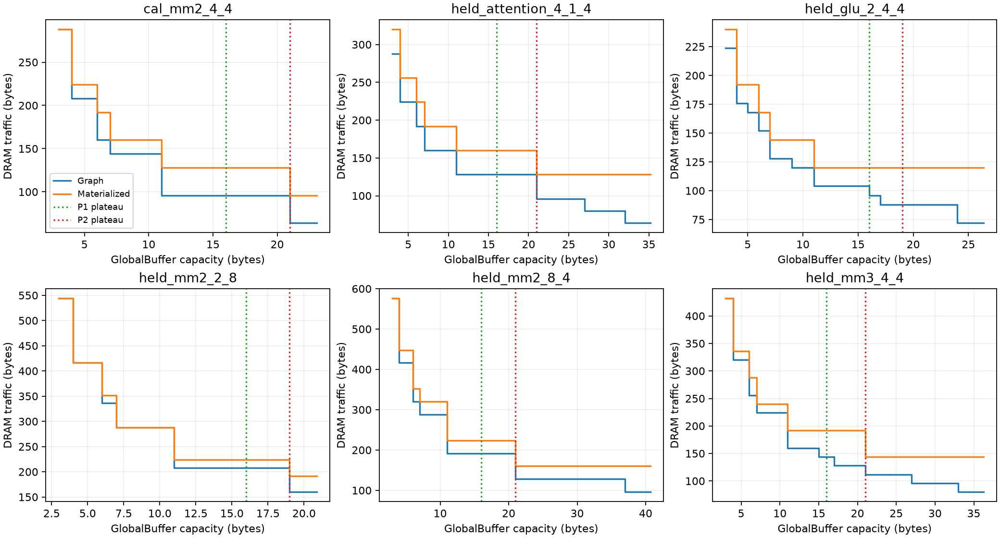

# Frozen structure-to-capacity predictions

The first native experiment rejects simple scalar composition of isolated
operator frontiers. It does not establish a new predictive theory or a
literature novelty claim. All measurements here use an abstract two-level,
serial, INT8 Snowcat-style architecture, source operator order and no
recomputation. They measure buffer capacity and DRAM bytes, not physical EDP.

## Completed measurements

Predictions were saved and hashed before each graph search; definitions and
evaluation thresholds are fixed in [PROTOCOL.md](PROTOCOL.md). P0 uses the
smallest full operand per operator. P1 adds full live tensors that pass the
current operator. P2 replaces the smallest operand with the isolated
operator's measured saturation capacity. Each takes a maximum over operators.

| Case | Native plateau, B | P0, B | P1, B | P2, B |
| --- | ---: | ---: | ---: | ---: |
| 2mm M4 KN4, calibration | 21 | 16 | 16 | 21 |
| 2mm M2 KN8 | 19 | 16 | 16 | 19 |
| 2mm M8 KN4 | 37 | 16 | 16 | 21 |
| 3mm M4 KN4 | 33 | 16 | 16 | 21 |
| GLU M2 G4 C4 | 24 | 8 | 16 | 19 |
| Attention proxy, tokens4 heads1 dim4 | 32 | 16 | 16 | 21 |

Across the five held-out cases, mean absolute relative plateau errors are
48.1%, 41.5%, and 27.0% for P0/P1/P2. P2 breakpoint micro precision is 70.6%
and recall 68.6%, using the preregistered 5% traffic-drop threshold and 5%
capacity matching tolerance. These are small selected workloads, not a
population estimate. P2 predicts one held-out plateau exactly and
underestimates the other four. It is not a validated upper or lower bound.



The strongest controlled counterexample is the two- versus three-operator
4x4 chain: identical per-operator geometry and isolated frontiers, zero
passthrough footprint under the declared accounting, and the same P2=21 B,
but native plateaus of 21 and 33 B. Taking a maximum of local saturation
capacities loses information necessary for composition. This motivates
inspecting tile compatibility and concurrent lifetimes. It does not yet
prove which compatibility attribute suffices, nor disprove every possible
cut-plus-tile predictor. P2 already retains several true small-capacity knees;
its missing larger knees are a concrete target for a subsequent hypothesis.

Local search alone costs 3.8–4.3 seconds per completed case; graph search
costs 3.4–8.7 seconds on this host. Replay and process startup add time.
There is no demonstrated end-to-end speedup, amortization result or hardware
selection benefit in this experiment. See [summary.json](results/summary.json)
for exact timings, evaluation and first measured fusion-benefit capacities.

## Trust boundary and failed real-program attempts

Every retained graph, local and materialized point in a completed case was
reconstructed and replayed at its stated capacity. Replay traffic must equal
search traffic and the sum of MainMemory actions; replay reservation must
fit. Unit read/write energy is one per bit, making energy/8 exactly DRAM
bytes. The materialized control explicitly keeps all tensors in MainMemory
and disables fused loops. Fresh ENERGY-only fixed-capacity searches around
every calibration knee agree with the envelope and pass witness replay;
see [fixed_capacity_check.json](results/fixed_capacity_check.json).

Reference means the attained native frontier inside the declared template
grammar and finite envelope (sum of full tensor sizes). It is not a proof
over all topological orders, all algorithms or all tilings. The proxy
attention/activation definitions come from existing workload YAML files.

| Registered real-program attempt | Outcome |
| --- | --- |
| Scaled MobileNet-28 | Graph Join fails at Depthwise0 / PiecewiseB0 after local predictions |
| Scaled GPT block | Initial replay validator rejects lifetime label; corrected retry fails Join at Q / QK |
| Original MobileNet-28, batch1 | 120-second watchdog timeout after local predictions, during graph search |
| Original GPT-6.7B geometry, tokens2 | Graph Join fails at Q / QK after local predictions, about 82 seconds |

No real-program global frontier above is accepted as ground truth. A Join
failure is not evidence that the workload is physically infeasible. Root
status files retain phases, wall times and sampled peak working sets. The
initial scaled GPT diagnostic itself hit a JSON scalar serialization error;
the repaired diagnostic is a separate retry. It finds matching traffic
(7,328 bits) at both claimed and envelope capacities, but buffer reservations
are labelled lifetime -1 rather than the validator's assumed 0. The validator
now checks every absolute GlobalBuffer reservation regardless of lifetime.
The subsequent `results/lifetime_retry` run fails earlier at Q / QK Join
(77 seconds), so this does not certify the GPT frontier. Run-to-run search
inconsistency is unresolved; no fixed Python hash seed was set in these runs.
Two earlier adapter issues are
also preserved in `results/adapter_failures`: isolated operators inherited
graph-scoped rename aliases, and pure copy operators had no buffer resource.
The adapter now clears unused aliases only for isolated searches and accepts
zero buffer only for declared native copy operations. Predictor definitions
were unchanged. `results/replay_attempt` preserves the pre-diagnostic retry.
Logs remain local because tracebacks contain machine paths.

The main sweep runs cases serially with one worker thread/process. A separate
scaled-GPT diagnostic retry overlapped the end of the original-GPT attempt;
failed-run timings are feasibility diagnostics, not comparative benchmarks.
No core mapper fix is included. Obtaining trustworthy GPT/MobileNet fronts
remains outstanding before making real-model claims.

## Reproduction

Use the [Windows runtime environment](../runtime/README.md). Choose a fresh
output directory: the supervisor refuses to overwrite existing case records.

```powershell
./research/runtime/run_windows.ps1 -PythonArguments @('-m','research.structure_prediction.run_cases','cal_mm2_4_4','held_mm2_2_8','held_mm2_8_4','held_mm3_4_4','held_glu_2_4_4','held_attention_4_1_4','--directory','research/structure_prediction/results/new_run')
./research/runtime/run_windows.ps1 -PythonArguments @('-m','research.structure_prediction.run_cases','scaled_gpt','scaled_mobilenet','original_mobilenet','original_gpt_tokens2','--seconds','120','--directory','research/structure_prediction/results/new_models')
./research/runtime/run_windows.ps1 -PythonArguments @('-m','pytest','research/structure_prediction/test_predict.py','-q')
```

`check_capacity.py` checks the saved root calibration curve. `summarize.py`
regenerates the root summary and PNG/SVG using only completed records.
Each case stores source workload hashes, dimensions, all tensor sizes,
prediction/protocol hashes, native mapping witnesses and per-tensor actions.
See `environment.json` for code provenance. The frozen protocol remains
unchanged after held-out outcomes; future predictors need a new protocol and
new held-out cases.
