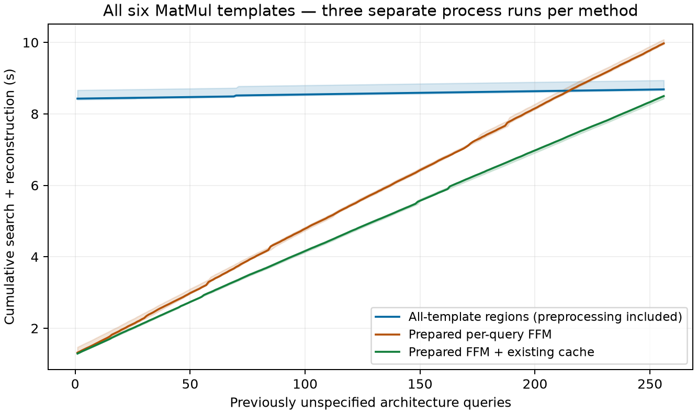

# Full six-template MatMul family: coverage works; preprocessing remains expensive

Base `60931a3e`, with the all-template terminal compiler in this commit. The normal
Mapper is unchanged. [Algorithm and limits](../../PARAMETRIC_OPERATOR.md).

**Main result:** all six templates jointly recover the configured single-operator
FFM frontier at the audited architectures. The final family representation is
compact. However, at 256 new queries it has **not beaten the existing cache**.
Do not carry the old single-template 1.49x result over to this experiment.

## Workload and protocol

One 256x256 MatMul, NVDLA, perfect tiling, Energy | Latency | Resource Usage,
zero Pareto tolerance, fixed unit costs/bandwidth, zero leakage and 8-bit Register.
All six templates are generated, with no template count limit. The integer family
is `Px=8..128`, `Py=16..384`, GlobalBuffer `32768..262144` bytes. PE count can vary;
this is not a fixed-area architecture comparison.

Template preparation occurs once at the family's upper corner and stops before
Tile enumeration. The region compiler receives the family bounds, **no query
architectures or target-optimal plans**. Only afterwards are 256 distinct query
points created: four named unseen shapes, then seeded random integer shapes and
byte capacities. Each method returns the complete terminal `(E,T,GLB bits)`
frontier and reconstructs the best-EDP Mapping.

Three fresh process runs per method, one worker, one numeric thread. Order is
rotated: `regions/independent/cached`, `independent/cached/regions`, then
`cached/regions/independent`. Every process receives the same generic Skyline
JIT warmup. Preparation, compilation, querying and selected-Mapping reconstruction
are timed; candidate fingerprints, JSON, and re-evaluation are not. No physical
oracle runs inside or between timed queries. After timing, **every** query's
selected Mapping is re-evaluated outside the cache scope.

The two strong baselines share immutable symbolic preparation and compiled final
cost functions, but execute the original FFM enumeration/constraints per query.
The cache baseline additionally uses the existing 64 MiB pure prefix/compilation
cache. Independently built full FFM is a correctness oracle, not a slower timing
baseline used to inflate speedup. Local machine: Apple M3, macOS 15.1, Python
3.12.14; versions are in [environment.json](environment.json).

## Preprocessing-inclusive cumulative time

Three-run medians, seconds:

| New architecture queries | Prepared FFM | Prepared FFM + existing cache | All-template regions |
|---:|---:|---:|---:|
| 1 | 1.317 | 1.291 | 8.427 |
| 16 | 1.820 | 1.736 | 8.441 |
| 64 | 3.503 | **3.158** | 8.484 |
| 128 | 5.711 | **4.941** | 8.570 |
| 256 | 9.973 | **8.499** | 8.686 |



Region preprocessing takes **8.397–8.664 s**. It breaks even against prepared
independent FFM at queries **224, 215 and 211**, respectively. Against the cached
baseline, there is **no observed break-even within 256 queries**, in any run.
At 256 queries the ratio of median baseline/region time is 1.148x for independent
FFM and 0.979x for cached FFM (regions take about 2.2% longer). The 64-query region
path is about 2.69x slower than the cache. We did not extend the measured range
post hoc to seek a favorable headline. Shading is the observed run range, not a
confidence interval; these are local measurements, not server results.

## Region growth and work

| Number of templates overlaid | Joint cells | Boxes |
|---:|---:|---:|
| 1 | 113 | 115 |
| 2 | 521 | 522 |
| 3 | 613 | 613 |
| 4 | 860 | 860 |
| 5 | 1,189 | 1,189 |
| 6 | 1,382 | 1,382 |
| After terminal Pareto and identical-source grouping | **255** | **255** |

The six templates' local partitions contain 2,394 boxes before overlay. This is
not a Cartesian product of every local region. Missing template portions remain
explicitly infeasible, and final cells merge only with identical retained source
IDs. Querying does no Pareto, enumeration or cost-formula evaluation.

| Work for the 256-query sequence | Prepared FFM | Existing cache | Region compilation |
|---|---:|---:|---:|
| Actual prefix expansion calls | 7,168 | **250** | 521 |
| Actual expanded rows | 450,888 | **21,348** | 107,193 |
| Final rows evaluated for Energy/Latency | 66,823 | 66,823 | **8,004** |

The cached path still receives 7,168 expansion requests; it serves 6,918 hits,
avoiding 429,540 requested rows. Its key/array payload peaks at 882,640 bytes with
no evictions. The region method executes 9,010 constraint/goal evaluations and
**901 actual prefix Pareto calls**, whereas the earlier single real template
executed none. Final-cost row counts exclude these partial evaluations.

Two templates account for much of the compilation cost. In the first saved run,
they take 2.626 and 2.817 s and peak at **715,873 and 859,854 rows** across their
regional states (28.6 and 34.4 million bytes of numeric prefix arrays). The overlay
takes 0.730 s and joint terminal Pareto 0.236 s. The final 255-box representation
therefore hides a substantially larger transient state-maintenance problem.
Process high-water RSS, sampled after timed search but before re-evaluation, is
0.331–0.354 GiB for regions, 0.261–0.288 GiB for independent FFM and 0.311–0.321 GiB
for cached FFM. These include Python/models, the retained query records and selected
Mapping objects; they are not isolated frontier memory or hard memory limits.

All six templates appear as selected best-EDP sources in this sequence. By
canonical template index 0..5 the counts are `129, 77, 24, 12, 9, 5`. These follow
the compiled source-ID tie rule; they do **not** prove each template is uniquely
optimal or count distinct optimal Mapping equivalence classes.

## Correctness evidence

- **1,382 joint-cell representative points:** every template's selected Tile
  set and the combined full terminal frontier match prepared independent FFM.
- **128 separate physical architectures:** 64 sampled terminal-boundary points
  (including adjacent PE integers/bytes) plus 64 held-out/random points. The
  normal complete `make_pmappings + join_pmappings` route generates the same
  six templates and selected Tile sets; the full `(E,T,R)` arrays match exactly.
  Only 64 of 3,148 available terminal-face/neighbor points were selected for
  this physical portion; it is not exhaustive physical boundary testing.
- **3,967 frontier-Mapping re-evaluations** at those physical targets, covering
  every returned frontier row, not only its best EDP. Independently searched best
  Mappings are re-evaluated too. Resources match exact integer bits and each
  spatial dimension is feasible; Energy/Latency retain the existing `1e-6`
  relative model re-evaluation criterion.
- All 256 queries in every performance run have successful selected-Mapping
  re-evaluation. The summary checks complete candidate digests and numeric
  frontiers across **all methods and repeats**, not only the last run. Digests
  include canonical Tile rows, dtype, shape and ordered symbol names.
- **409 research/Streaming regression tests passed**, including 18 new tests for
  region subtraction/coverage, holes, unavailable equal-cost provenance, physical
  full-FFM comparison, source IDs, query immutability, and an injected early-run
  reporting mismatch. Monkeypatch guards reject any query-time enumeration,
  cost evaluation or Pareto invocation.

[Audit](audit.json) and [regression](regression.txt). This is equivalence to the
configured FFM selection policy, not exhaustive proof over every physically
possible Mapping. Re-evaluation still uses FFM's model. The resource-frontier
experiment uses the same metrics on both sides; no EL/RU ablation is mixed in.

## Reproduction and interpretation

```sh
export PYTHONHASHSEED=0 OMP_NUM_THREADS=1 OPENBLAS_NUM_THREADS=1 NUMBA_NUM_THREADS=1
out=/tmp/parametric-operator-results
for entry in regions:1 independent:1 cached:1 independent:2 cached:2 regions:2 cached:3 regions:3 independent:3; do
  benchmark_mode=${entry%:*}
  repeat_id=${entry#*:}
  python -m research.tracking_audit.benchmark_parametric_operator --mode "$benchmark_mode" --queries 256 --output "$out/${benchmark_mode}${repeat_id}.json"
done
python -m research.tracking_audit.summarize_parametric_operator "$out"
python -m research.tracking_audit.audit_parametric_operator --output "$out/audit.json"
python -m pytest -q --disable-warnings research/tracking_audit research/streaming_join
```

Raw runs: [regions 1](regions1.json), [2](regions2.json), [3](regions3.json);
[independent 1](independent1.json), [2](independent2.json), [3](independent3.json);
[cached 1](cached1.json), [2](cached2.json), [3](cached3.json).
[Summary](summary.json) includes phase/work counts, break-even status and all
query checkpoints. Code hashes identify the working implementation used.

The six-template coverage milestone is achieved. The results do not establish
that extending parameter regions always improves execution: transient per-template
states dominate preprocessing, despite a compact final union. Fusion and varying
bandwidth costs remain unimplemented. In particular, these three terminal scalar
objectives cannot replace FFM's full boundary/resource/component-latency state
when two operators are composed.
