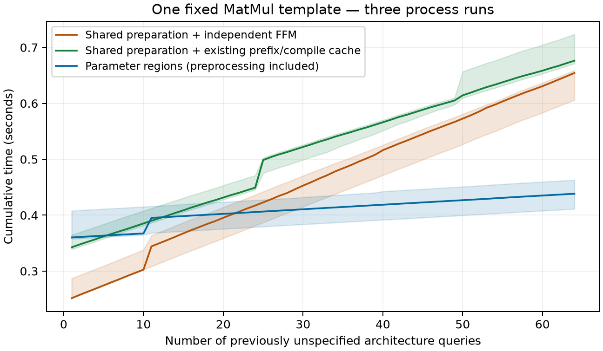

# One-template integer architecture-region experiment

Code base: `6282c980` plus the opt-in research interpreter in this commit.
The default Mapper is unchanged. See [algorithm and projection argument](../../PARAMETRIC_TEMPLATE.md).
This experiment answers previously unspecified architectures within a declared
family; it is not retrospective retargeting from target-optimal Mappings.

## Scope and construction

One 256x256 MatMul, fixed NVDLA topology and unit costs, zero leakage, 8-bit
Register, perfect tiling, zero Pareto tolerance. The family is:

```
8 <= Px <= 128; 16 <= Py <= 384; 32768 <= capacity_bytes <= 262144
```

All parameters are integers. Array PE count is allowed to change; this is not
a fixed-area hardware comparison. Unit costs/bandwidth and physical topology
do not change. The selected template is the lexicographically first canonical
unfused template, chosen without query costs or winners. Only this template is
searched, although the upstream preparer finds six available templates.

Preparation at the upper corner captures the original symbolic program before
any Tile enumeration. The compiler receives the box above, **not** a list of
architectures. It splits on exact attained fanout/resource events and shares
states only when ordered assignments, dtype and prefix Pareto history agree.
Disconnected regions are allowed. Its result is **113 final execution states,
115 boxes and 675 distinct Tile assignments**. These are execution-policy
regions, not 115 globally optimal-Mapping regions.

After compilation, the benchmark creates 64 queries: four named unseen shapes
(`48x128`, `24x256`, `96x64`, `40x160`) followed by seeded random integer shapes
and byte capacities. No Tile choices or target search results enter compilation.
The complete query sequences, region boxes, selected Tiles and numeric frontiers
are saved in each raw run. Queries return all retained Tiles and the final
Energy/Latency/GlobalBuffer-bits frontier, then reconstruct the best-EDP Mapping
from its stored Tile provenance. They do not call enumeration or cost formulae.

## Timing, including preprocessing

Three process runs, each followed by a fresh-process cached-baseline run, on the
local machine with one worker and numeric thread counts fixed to one. A generic
two-row Skyline invocation warms JIT before timing. Environment details are in
[environment.json](environment.json). Full target re-evaluation is outside all
timers; **best-Mapping reconstruction is inside every method's query time**.

| Method, 64 new queries | Median total |
|---|---:|
| Shared symbolic preparation + original per-query FFM | 0.654 s |
| Same prepared program + existing `EnumerationReuse` prefix/compilation cache | 0.676 s |
| Whole-family region compilation + queries | **0.438 s** |

Ratio of medians: **1.49x** against prepared independent FFM, **1.54x** against
the cache variant. Preprocessing takes 0.357–0.407 s; all 64 region queries
including best-Mapping reconstruction take 0.052–0.082 s. These component ranges
are not additive medians. Against the faster independent baseline, cumulative
break-even occurs at queries **26, 24 and 18**, respectively. Few-query use is
slower because it pays for the full family's compilation upfront.



Lines are medians and shading is the observed three-run range, not confidence
intervals. The prepared independent pass shares a process with region compilation
and the physical oracle, which can warm global symbolic caches; the cached variant
runs in a separate fresh process with the same generic JIT warmup. Both baselines
share immutable symbolic preparation and compiled final-cost functions. Their
remaining policy evaluation is per-query. These subsecond local measurements are
preliminary and are not server, full-Mapper or multi-workload DSE speedups.

The separately constructed physical-architecture oracle's cumulative timing is
also archived (median 3.867 s), but **is not the headline baseline**: repeatedly
preparing the same template overstates the opportunity available to a prepared
optimizer. Benchmark validation never supplies choices to the timed search.

## Work reduction is not uniform relative to caching

| Work for the 64-query sequence | Prepared independent | Existing cache | Region compilation |
|---|---:|---:|---:|
| Actual prefix expansion calls | 256 | **26** | 36 |
| Actual expanded rows | 3,331 | **501** | 834 |
| Final Tile rows receiving Energy/Latency evaluation | 1,282 | 1,282 | **675** |

The cache serves 230 of 256 expansion requests, avoiding 2,830 requested rows;
its retained key/array payload peaks at 15,688 bytes. It still applies ordered
constraints separately for each query and evaluates each query's final candidates.
The region compiler covers the **whole family**, including unqueried regions, and
performs 94 constraint/goal value-evaluation calls and 156 event splits. Its
measured prefix-state payload peak is 91,744 bytes across 2,867 rows; this excludes
Python objects, intermediate allocations and final tables, and is not peak RSS.

Thus **do not claim fewer actual expansion rows than the existing cache**. The
evidence is that whole-family policy execution plus deduplicated final-cost
evaluation amortizes over this query sequence. Final-cost row counts count each
row evaluated for Energy and Latency once; they exclude partial constraint and
Pareto-goal evaluations. The real template has **zero prefix Pareto calls**,
because its regional prefixes stay below FFM's 100-row threshold. A separate
synthetic test exercises that mechanism.

## Correctness evidence

- Every measured query compares its full selected Tile set and final `(E,T,R)`
  frontier with both prepared per-query FFM and a separately built physical
  architecture at that exact shape/capacity. Arrays/frontiers match exactly.
- The selected Mapping is reconstructed for every run and re-evaluated at its
  target. Energy/Latency use the existing `1e-6` relative re-evaluation criterion;
  original GlobalBuffer bits match exactly, capacity is checked in integer bits,
  and each spatial dimension is checked separately. No tolerance was relaxed.
- [Boundary audit](boundaries.json): **1,406 points** at box endpoints and adjacent
  PE integers/bytes all match independently constructed physical architectures,
  including complete Tile sets/frontiers and the reconstructed best Mapping's
  costs and exact occupancy. These are deliberately boundary-biased tests, not
  random estimates of failure probability or 1,406 distinct Mapping identities.
- [Regression](regression.txt): **391 passed**, including 22 new tests. They cover
  300 exhaustive small three-parameter projections, state order/dtype/history,
  explicit budget failure, out-of-family rejection and a one-bit boundary beyond
  float32 precision. Monkeypatch guards prove queries do not invoke Tile expansion
  or final-cost evaluation.
- Actual prefix Pareto is tested with the historical raw-resource example:
  Tile `(2,1,2)` occurs at `[5,6] union [26,128]`; all 128 independent integer
  projections match. Region compaction preserves its hole.

These validate the **same template and existing FFM selection policy**. They do
not prove full physical Mapspace completeness or optimality over all six
templates. Re-evaluation also uses FFM's model; it is not an independent hardware
resource-lifetime simulator. Fusion, bandwidth variation, differing storage
placements/topologies and global memory bounds remain outside this prototype.

## Raw records and reproduction

Paired runs: [run1](run1.json)/[cached1](cached1.json),
[run2](run2.json)/[cached2](cached2.json), [run3](run3.json)/[cached3](cached3.json).
[Summary](summary.json) contains counts and cumulative query checkpoints. Each
raw record includes source hashes; the summarizer refuses mismatched code or
query sequences and checks the cache run's exact reference-file hash.

From the repository root, using the project environment:

```sh
export PYTHONHASHSEED=0 OMP_NUM_THREADS=1 OPENBLAS_NUM_THREADS=1 NUMBA_NUM_THREADS=1
out=/tmp/parametric-template-results
for run in 1 2 3; do
  python -m research.tracking_audit.benchmark_parametric_template --queries 64 --output "$out/run${run}.json"
  python -m research.tracking_audit.benchmark_parametric_cached_baseline --reference "$out/run${run}.json" --output "$out/cached${run}.json"
done
python -m research.tracking_audit.summarize_parametric_template "$out"
python -m research.tracking_audit.audit_parametric_template --output "$out/boundaries.json"
python -m pytest -q --disable-warnings research/tracking_audit research/streaming_join
```

This delivers the requested one-template feasibility experiment. Extending the
same representation to all templates, then Fusion-safe composition, still needs
separate quality and end-to-end cost evidence; the result does not justify a
claim that a general parameterized Mapper has already been built.
