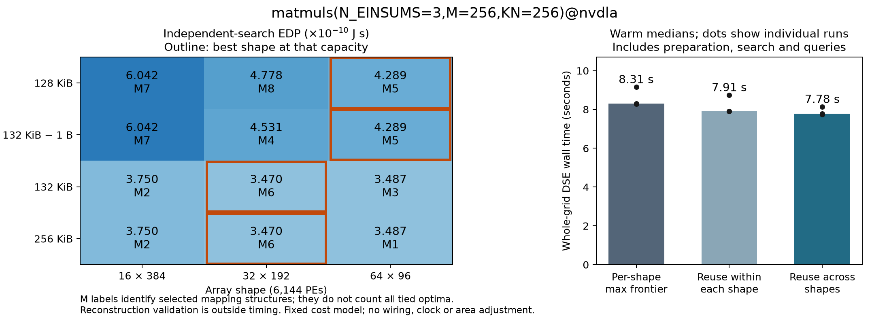

# Array shape × capacity: architecture decisions and a reuse baseline

Historical baseline at `ef779da6`. The Attention permutation-matching failure
below is now diagnosed and repaired; see the [follow-up audit](../retargetability/README.md).
The original failures and timings are preserved as measurements of that revision.

This experiment shifts the question from membership encoding to architecture
selection. It implements a conservative cross-shape execution-reuse baseline,
not a new fusion contract or a joint search over spatial bindings.

## Architecture selection reproduced



Three serial 256×256 MatMuls, NVDLA cost model, 6,144 configured PEs, no template
count limit, existing conservative fusion filter. EDP below is in 10^-10 J s.
Each of these **12 independently selected mappings** was reconstructed and
re-evaluated at its actual array shape and integer-byte capacity. Spatial
unfolding is checked per array dimension, not just by total active PEs.

| Shape | 128 KiB | 132 KiB − 1 B | 132 KiB | 256 KiB |
| --- | ---: | ---: | ---: | ---: |
| 16×384 | 6.042042 | 6.042042 | 3.750344 | 3.750344 |
| 32×192 | 4.778393 | 4.531050 | **3.470097** | **3.470097** |
| 64×96 | **4.288793** | **4.288793** | 3.487105 | 3.487105 |

For 32×192, 132 and 256 KiB select the same mapping identity, using 132 KiB.
The one-byte boundary reduces its EDP by 23.4%. At 128 KiB, 64×96 improves EDP
by 10.25% over 32×192; at 132 KiB their difference is only 0.49%.
These are cost-model predictions with fixed action costs and clock. No physical
area, wiring or timing adjustment is made when the array aspect ratio changes.

The strong baseline searches **once per shape at maximum capacity**, retaining
the whole GlobalBuffer/energy/latency frontier, then filters exact bit demands.
It selects the same winning architecture at all four capacities. It does not
match every cell: 16×384 at 128 KiB gives 6.060757 instead of 6.042042 (0.31%
worse). It is a strong physical-feasibility baseline, not a complete oracle for
the smaller capacity's ordered fallback policy.

Mapping labels identify selected structures, not all possible tied optima.
Nested decisions and identities are in [the mapping key](matmul_shape_capacity.mappings.json)
and [independent results](matmul_independent.json). PDF: [main figure](matmul_shape_capacity.pdf).

## Does simple cross-shape reuse beat this baseline?

`EnumerationReuse` is an explicit, serial, bounded-lifetime context. It shares:

* Pure prefix expansions with exactly equal ordered arrays, dtype, symbol order,
  complete symbol relations (including initial-delta order), and tiling mode.
* Compiled expressions with equal expressions, ordered symbols and numeric type.

Every shape still generates its own templates and executes its own capacity,
spatial, ordered fallback, Pareto, and fusion compatibility rules. No selected
mapping or pruning history is transferred between shapes. Cache arrays are
read-only; nested scopes and parallel workers are rejected. The numeric/key
payload budget is 64 MiB, with entry limits; this is **not a process memory bound**.
The default mapper does not activate the context.

To separate reuse within one shape from actual cross-shape reuse, compare a fresh
scope per shape (`local_reuse`) with one scope for the entire DSE (`reuse_frontier`).
Each timed batch starts with empty explicit reuse stores. One warmup per method,
then three alternating serial measurements; no performance processes ran in
parallel. Timing includes spec construction, scope setup/teardown, generation,
Join and all capacity selections, and excludes reconstruction validation and
snapshot serialization. Every warmup and measured pick is validated.

| Workload / grid | Strong baseline | Reuse within each shape | Reuse across shapes |
| --- | ---: | ---: | ---: |
| MatMul chain, 3 shapes × 4 capacities | 8.309 s | 7.912 s | 7.783 s |
| QK → QK_softmax → AV, 3 shapes × 3 relaxed capacities | 5.642 s | 5.535 s | 6.231 s |

These are local macOS arm64/Python 3.12, one-worker warm medians, not server
eight-worker results or statistically established speedups. MatMul's ratio to
the strong baseline is 1.068×, but only 1.017× relative to within-shape reuse.
Attention is slower (0.906× baseline speed). The mechanism is a memoization
baseline, **not evidence of a new cross-shape search algorithm**.

For MatMul, 44,932 requested expansion rows become 24,859 executed rows, but
only **756 rows** are attributable to hits from another shape. Most savings
are within-shape reuse. There are 1,012 cross-shape compilation hits. This
distinction prevents reporting all cache savings as cross-architecture work
reduction. Complete sorted numeric frontiers, including dtypes, match for every
method/repeat. MatMul has 144 validated picks including warmups; relaxed
Attention has 108. These are evaluation counts, not independent mappings.

Raw files: [MatMul timings](matmul_reuse.json), [relaxed Attention timings](attention_relaxed_reuse.json),
[summary](summary.json), [tests](regression.txt). The initial MatMul timing archive
predates metadata/diagnostic-output additions; subsequent tests check the final
source. Those changes do not alter enumeration or the MatMul model.
The research/Streaming suite reports **362 passed**. The separately saved
Attention failure below remains a known counterexample outside those passing tests.

## Low-capacity Attention exposes a pre-existing correctness failure

Attention uses the three equations from `examples/workloads/gpt3_6.7B.yaml`, with
128 tokens, one head, head dimension 64 and 8-bit values. **QK_softmax is the
repository's elementwise proxy, not a complete softmax implementation.**
The Register is explicitly fixed at 8 bits throughout the graph. Stock NVDLA
uses a dummy 1-bit size for weightless Einsums; inconsistent per-Einsum capacity
metadata otherwise prevents the Join. Weightless stages store no weight there.
This fixed setting is used by every method and reconstruction.

At 32/64/128 KiB, capacity does not change the selected mapping for each shape.
Testing 8/16/24/32/128 KiB instead finds **two invalid selected mappings** on
64×96, at 8 and 24 KiB. Independent search, strong baseline and reuse all select
rows with the same reconstruction mismatch. In the 8 KiB case:

| Quantity | Search row | Reconstructed mapping |
| --- | ---: | ---: |
| Energy (J) | 5.805113092e-6 | 7.277510656e-6 |
| Latency (s) | 1.830399999e-5 | 1.894400000e-5 |
| GlobalBuffer bits | 65,536 | 65,536 |

The standalone reproducer was also run with imports from a **clean detached
`e76e66bf` worktree**, without any new reuse or audit helper. It reproduces both
the energy and latency discrepancy: [original-commit result](attention_e76_repro.json).
This rules out the new reuse implementation as its cause. The root cause is
not yet localized to a particular fusion/score/reconstruction operation.

The [diagnostic grid](attention_pressure_diagnostic.json) records 45 selections,
six failures (the same two points across three methods), complete nested mapping
decisions, and `all_picks_valid: false`. Both diagnostic and fail-fast scripts
exit nonzero. Numeric-frontier equality is true here and plainly does **not**
certify reconstruction correctness. These timings and scores must not be used
to claim valid architecture choices or performance on the pressure grid.

This issue remains **unfixed**. The useful next step is to isolate the responsible
partial mapping and fusion reconstruction before expanding the Attention DSE.
The proposed shape-dependent storage/spatial-binding search still remains future
work; the current context supplies its exact-input reuse baseline.

## Reproduce

From the repo root, with dependencies installed:

```sh
export PYTHONHASHSEED=0 OMP_NUM_THREADS=1 OPENBLAS_NUM_THREADS=1 NUMBA_NUM_THREADS=1
python -m research.tracking_audit.shape_capacity_audit --methods independent --output /tmp/matmul-independent.json
python -m research.tracking_audit.shape_capacity_audit --warmup --repeats 3 --output /tmp/matmul-reuse.json
python -m research.tracking_audit.plot_shape_capacity --picks /tmp/matmul-independent.json --timings /tmp/matmul-reuse.json --output /tmp/matmul-shape-capacity
python -m research.tracking_audit.shape_capacity_audit --workload attention --params 128,1,64 --capacities-bytes 32768,65536,131072 --warmup --repeats 3 --output /tmp/attention-relaxed.json
python -m pytest -q --disable-warnings research/tracking_audit research/streaming_join
```

The following **is expected to exit 1 on the known failure**, after saving JSON:

```sh
python research/tracking_audit/repro_attention_shape.py --arch examples/arches/nvdla.yaml --output /tmp/attention-failure.json
python -m research.tracking_audit.shape_capacity_audit --workload attention --params 128,1,64 --capacities-bytes 8192,16384,24576,32768,131072 --methods independent,max_frontier,reuse_frontier --collect-failures --output /tmp/attention-pressure.json
```
